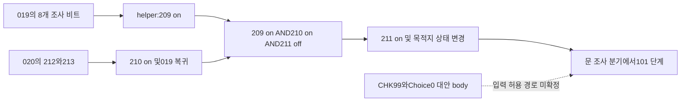

# 03 — 수사·조사·언령 획득

## 조사와 확인 범위

수사는 대화와 재판 사이의 단순 화면 전환이 아니라 탐색 상태·상호작용 대본·플래그·증거 데이터·획득 UI·종료 조건을 함께 사용한다. 실제 원본 바이트와 native 처리기를 대조했으며, 전체 수사 파트를 플레이하거나 모든 해금 조건을 실행 검증한 것은 아니다. 공간 구조와 충돌은01, UI payload 형식은06을 따른다.

## 별도 수사 진입점과 공간 복귀

resident `Chapter.dat`는 장마다 수사 진입점 열을 가진다. 첫 장의 예는 `chap1/chap1_invest`다. `0x140478c90`의 업데이트는 UI/지도에서 반환한 식별자를12바이트 레코드의 조건과 비교해 공간/진행 상태를 갱신하고, 다음 WRD를 실행한다. 이 함수가 부르는 `0x140478010`은 `mapjump_data.dat`를 가져온다. 값의 연결은 계속 해독 중이며 지도 메뉴의 목록 순서를 원작의 공간 전환 규칙이라고 간주하지 않는다.

`HUM` 처리기 `0x140466ce0`는 탐색 준비가 안 됐으면 명령 위치를 되돌려 기다린다. 준비되면 이전에 저장한 탐색 진입 IP를 복구하고 장면별 탐색 상태를 활성화한다. 근거 `ev_a6212703759f553ab4bc65b12d5c356e2fced0606a963679754be8dcc631b595`. 따라서 조사 대화에서 나올 때는 방 배경을 새로 여는 것뿐 아니라 탐색 문맥을 복원해야 한다.

## 언령은 CHK가 아니라 별도 KTD 처리다

공개 WRD 명령 주석의 'CHK가 언령을 더한다'는 해석은 이 설치본 native와 맞지 않는다. CHK는 checkpoint 숫자/ChkEnd/ChkTimeOut/ChkHeartZero/ChkQuestion 분기와 연결된다. 언령의 획득·표시 처리기는 KTD `0x14046af30`이다. dispatcher opcode11→해당 주소의 연결은 `native/wrd_dispatch.json`에서 확인한다. 근거 `ev_e711185f23bf7ecf449c66694401bd9213b91ecce0aead76af3efe3ccc9f5ba5`.

이 처리기에는 `alloff` 분기와 획득용 상태, `fl_in`/`fl_out`, `GetKotodama` 관련 UI 이름이 있다. 단순한 `cards.insert()` 하나로 획득 완료까지 처리하면 저장/상태 변경과 진입·기다림·퇴장 시점을 놓친다. 모든 조건의 실행 순서는 상세 pseudo와 후속 함수 소비를 통해 확인해야 하며, 문자열 존재만으로 획득 애니메이션 길이를 확정하지 않는다.

## 실제 언령 데이터

경로는 `partition_resident_win.cpk/game_resident/game_resident.spc/Kotodama.dat`다. 200행이며 데이터 시작224, 행 간격22바이트다. 같은 라벨의 문자열과 이미지 참조를 다른 층에서 조회한다.

| 행 내 오프셋 | 내용 |
|---:|---|
|0|라벨 문자열 참조|
|2|저장번호 u16|
|4|사용 장 참조|
|6|이름 문자열 ID|
|8/10/12|설명1/2/3 ID|
|14|거짓 탄환 이름 ID|
|16/18/20|이미지1/2/3 리소스 문자열 참조|

이는 여러 설명/이미지를 가진 증거 항목과 거짓 탄환 이름을 저장하는 구조의 증거다. 모든 항목이 항상3페이지로 표시된다는 뜻은 아니다. 원작 증거 문장·그림은 저장소에 복사하지 않는다. 상세 JSON SHA는 `c62a7a2d63787ec4628f87edb5d3fdeb057d441adfb4168593aee56e274ff1c4`다.

일반 대화 최종 setter `0x140358660`은 현재 상황 문자열이 `tansaku_undaily` 또는 `tansaku_investigte`이고 특정 UI 상태 조건이 맞으면 별도 UI 속성 갱신을 수행한다. 이 오타를 포함한 실제 이름은 원문 그대로 보존했다. 수사 대화를 일반 일상 대화와 완전히 같은 표시 정책으로 가정하면 안 된다. 근거 `ev_188e95e98e5f41347c9915c74f1c7061d9fbf7c9af7ce162fcc13f5d00f1119e`.

## 첫 수사의 조건부 진행을 기술 ID로 연결

분석 단위는 `chap1/chap1_invest`→scene100..107→`chap1/c01_200_000`의 정적 연결이다. US 우선 technical007 원장을 재사용하여 진입·구역 조사·증거 등록·반복 조사·완료 helper·모드 전환을 연결했다. 선택한29개 script에는 다음 모드의 setup 경계도 포함한다. 원본 대사·증거 설명·줄거리 문장을 복사하지 않았다. 설치본의 정상 실행 기준선과 최종 표시 화면은 확인되지 않았으므로 이 절을 플레이 완료 기록으로 읽지 않는다.

### 분기의 방향과 상태 수명을 먼저 구분

native dispatcher `0x14045b310`은 opcode를 읽고 IP를2바이트 전진시킨 뒤 IFF/IFW handler를 호출한다. `0x140466ff0`/`0x140467450`의 조건이 참이면 CED와 false용 JMN을 건너 true body로, 거짓이면 JMN을 거쳐 false label로 간다. 이번 도구는 이 **정형 CED/JMN/LBN 영역만** 표시한다. 임의 script를 실행하는 새 VM을 만들거나, 지역 조건 하나를 전체 경로의 필요충분조건으로 바꾸지 않았다.

상태도 단계 경계를 가진다. scene100 초기화는 `flg200..220` 21개를 끄지만, scene101..107 초기화는 각각 `flg200..215` 16개를 끈다. 따라서 scene100의 `flg202`와 scene103의 `flg202`는 같은 저장 비트라도 다른 조사 역할로 재사용된다. 모든 단계가220까지 초기화한다고 일반화하지 않았다. 8개 초기화 script의 실제 명령·offset은 `investigation_flow/first_case_causal_proofs.json`의 reset 원장에 있다.

### 초기 두 구역: 조사 결과가 완료 helper에 모이는 방식

scene100의 한 완료 경로는 `c01_950_000` helper다. 이 helper가 `flg209`를 켜는 조건은 **200·201·202·203·204·205·206·216 여덟 비트가 모두 on**인 것이다. 각 비트를 만드는 선택 문맥은 다음과 같다. HUM 번호는 인물 선택 ID이며 place의 `CharaPos` 슬롯 번호와 혼동하지 않는다. 정상 CHK100 이상은01에서 확인한 물체/구역 ID+100 전달과 연결한다.

| 구역·선택 ID | 갱신 비트 | 함께 호출하는 KTD ID 끝자리 | 갱신 offset |
|---|---:|---|---:|
| `100_019` HUM0 | 200 | 01,02 |9380|
| `100_019` HUM14 |201|없음|15346|
| `100_019` CHK106 |202|03|18268|
| `100_019` CHK107 |203|없음|19214|
| `100_019` CHK108 |204|없음|19924|
| `100_019` CHK101 |205|04|16548|
| `100_019` CHK105 |206|05|17318|
| `100_019` HUM12 |216|16|13476|

KTD ID의 접두어는 모두 `kotodama_1_`이다. 증거 획득이 없는 대화·물체 조사도 이 helper의 조건에 들어간다. 반대로 조사 대상 전체를 방문했는지를 검사하는 배열 순회는 이 조건의 대체물이 아니다.

다른 구역 `100_020`의 CHK101은 KTD08과 비트213을, CHK102는 KTD07과 비트212를 만든다. 둘 다 on이면 `lab_Jump12`로 넘어가 비트210을 켜고019로 복귀한다. helper는 **209on && 210on && 211off**를 확인한 뒤211을 켜며, 목적지 MPF와 exit 관련 상태를 갱신한다.019의 문 조사 CHK107/108은211off일 때 구역에 남는 분기, 그렇지 않을 때101 단계로 넘어가는 분기를 갖는다. 구역 이동·대화·증거 등록이 각각 별도 상태를 갱신해 합쳐지는 구조다.

**이것을 첫 수사 전체의 「필수10대상」이라고 단정하지 않는다.**019에는 CHK99→Choice0→`lab_Jump10`→101의 별도 exit body도 있다. 해당 결과에 도달하는 입력·현재 manager 상태까지 모두 해결하기 전에는 helper211을 모든 진행 경로의 유일한 완료 gate로 사용할 수 없다. `0x14040bda0`도 추가 확인했지만 이 함수는 target/cursor UI 정보를 포장하는 소비여서 exit 입력 허용을 해결해 주지 않았다. 대안 경로를 지우지 않고 원장에 남겼다.

인물 배치에 관한 반증도 보존한다. 비트210on branch에 C012/C014 load가 있지만, off branch에도 같은 ID의 load가 있다. 한쪽 load만 보고 두 인물의 신규 등장 해금이라고 설명하는 가설은 맞지 않는다. 실제 선택 가능 시점은 이후 fade·표현·hit 상태까지 확인해야 한다.

### 대안 exit의 입력·완료 결과·CHK98/99 선택

직접 실행 없이 정적 native 소비를 추가로 연결했다. 활성 조사 `409240`의 모드0에서는 결정 입력과 앞선 물체 동작 분기가 없고, `3c7290` 입력 및 manager+210 gate가 맞으면 상태4/하위0을 요청한다. 기존+350·자원 상태·조사 활성 조건도 통과해야 하므로 단일 키만으로 모든 상황에서 요청한다고 쓰지 않는다. `3c7290`은+4c>2 및+44==2의 shortcut 외에는 global+ea8에 따라 논리 bit0x40/0x20을 고르고 키보드·패드의 새 누름을 검사한다. 현재 config와 장치 경로를 생략한 고정 물리 키 설명은 피한다.

상태4의 `4094c0`은 결과 kind1,target−1,aux1,ready3을 만들고 일반 정리 또는 특수 상태6 정리를 요청한다. WRD 소비 `456d80`은 kind1/2에서 target+100을 만든다. −1은99지만 곧바로 CHK99에 고정하지 않고 **flag143이 꺼졌으면98, 켜졌으면99**로 다시 선택한다. `478300(143)`은 working+6d0 bit15를 읽는다. 그 뒤 working+16ac를 지우고 manager+ab6c를 세운 뒤 해당 checkpoint를 요청한다. 대상 없는 exit 결과와 실제 다음 단계 허용을 분리한 구조다.

기술 대본019의 진입부@36은209on이면@50에서 `flgMapExitCross`를 켜고, 아니면@64에서 끈다. helper950_000의@116은209on&&210on&&211off인 다른 조건에서@762 MapExitCross와@768의211을 켠다. 따라서 helper211은 모든 exit 허용의 유일한 쓰기가 아니다. CHK99@15668→Choice0@15698→Jump10@15714→FIL101@15822 경로는 이 결과 라우팅과 연결되지만, 모든 간접+210 writer·플래그 작성·전역 도달 가능 상태는 아직 닫지 않았다. 여덟 비트가 전역 최소 필수 집합이라는 결론도 내리지 않는다.

근거: 결과 `ev_3eb1a0a9537aea9380f74b28af6c95293a8d5a9dd37a62ed6cbcf303ecff7496`, 입력 `ev_922f39ce4e39e53cd5af9665ec0a3a50f16e68c40d6b5b5a84c8eb068f3151d0`, 비트 조회 `ev_bafe286d80cca9c7cc0df7031841d87b01d95bfd21bfcd9e23eaeb07bfcbcb71`, 결과 소비 `ev_23d247969dbd7a0b9da1eb6889fecf67cdc863969eaa28a85aa9331c16020782`다. 외부 `native/investigation_exit_closure_findings.json`, `close_investigation_exit.py`가5함수와11개 기술 명령의 SHA·offset·인자를 재대조한다. 이 후속은 이전의 대안 입력 미확정 중 조건부 생산·소비를 좁힌 결과이며 전체 수사 플레이 증명이 아니다.

### 대안 종료 입력의 기본 허용값과 객체 수명

위 대안 입력의 manager+210 허용값은 생성 경로에서 추가 확인했다. 초기화3bbfa0은405c60을 호출한다. 이 함수는 전역c25a30이 없을 때만0x380바이트 탐색 객체를 만들고407ce0으로 초기화한다. getter405dd0은 같은 전역을 반환한다.407ce0은+210=1,+214=1,+218=1,+21c=0을 설정한다. 따라서 새 객체의 대안 종료 허용값은 기본on이지만, 생성 직후 탐색 준비까지 끝나 입력이 무조건 통과한다는 뜻은 아니다. 기존 객체가 있으면405c60은 생성·초기화를 건너뛰므로 방에 들어갈 때마다 이 값이 다시1로 설정된다고 일반화하지 않는다.

이로써 정상 입력 계약은 두 층으로 더 좁혀진다. 활성 mode0과 앞선 입력/물체 처리 조건을 통과한 뒤, 대안 입력3c7290과 manager+210이 참이면 종료 요청을 만든다. 이후456d80이 **별도의 script flag143**을 읽어CHK98 또는99를 선택한다. flag143이off여도 native 허용값이on이면 요청을 받고CHK98로 보낼 수 있다. 진행 플래그off를 곧바로「입력 자체를 무시한다」로 구현하지 않는다. 반대로 manager 허용값이off이면 이 대안 입력 가지에서 종료 요청을 만들지 않는다.

raw4063a0은 EDX를+218, R8D를+210에 쓰는 짧은 setter다. provider가4063a6을 포함하는 함수를 정의하지 않아 raw 바이트로 확인했으며 같은 디컴파일을 반복하지 않았다. setter 진입4063a0의 직접 xref는 현재 비어 있다. 이를 모든 간접 호출·별칭을 통한 필드 변경이 없다는 증거로 바꾸지 않는다. 생성 wrapper405950에도407ce0 호출이 있지만 확인된 incoming은 예외 메타데이터뿐이므로, 실제 초기화 연결은3bbfa0→405c60을 근거로 삼았다.

특히 **manager offset+210과 대본의 flg210은 다른 상태**다. 첫 수사 helper의209&&210&&!211은 script bit 조건이며 native 객체+210을 쓰는 문장이 아니다. 수사 완료 조건과 입력 허용값을 숫자가 같다는 이유로 합치지 않는다. 네 가지 합성 사례(manager 허용0/1 × flag143 off/on)는 앞선 상태·입력 조건을 통과했다는 전제에서 요청 없음/CHK98/CHK99를 대조한다. 전 장의 모든 도달 경로나 최소 필수 조사 집합을 푼 결과는 아니다.

근거: 전역 생성 `ev_44a0ca5fe21ef9f2f7e7cd04ddc9d70ba5e0139175b4c83d900b62596a45fa62`, 생성 시 기본값 `ev_853665bc1376aa14a04c84ecd822d50733a9eabe524b542ab9d12fb5bf49650f`, 전역 getter `ev_df218c26c9ed096f1df070e0bc7c2d4f662a3666410accc538f5feca4df8169d`, raw setter `ev_228dce973237f3d229772da02f0d4703256baf39a6e8a4a2c3cb5eb2cb20c540`, setter의 제한된 xref 결과 `ev_2514e42477a1514873e0e92fa9f68d1f5a5f83ee92bc2a4e5ffa772a272d37da`다. 외부 `native/exploration_exit_default_findings.json`과 `close_exploration_exit_default.py`에10개 함수와4개 합성 사례, 검색 한계를 기록했다. 원작 실행·UI·프로세스 읽기·신규 추출·Game 변경은 없었다.

### 후속 단계에서 무엇이 다음 장소를 열어 주는가

| 단계 | 정적으로 연결한 상태 변화와 이동 |
|---|---|
|101|`101_004` CHK102 body가 map025를 준비하고004를 삭제한 뒤102 초기화로 넘김|
|102|025의 첫 진입 branch가 KTD09와200을 등록.026행 문 body는200on 조건을 가짐.026의 CHK113은 KTD10·202를 만들고 `950_001`이202on&&206off에서206을 켬.025에는206off의 잔류 분기와 이후 확인 선택→103 body가 따로 존재|
|103|017의 초기 branch가 KTD17·06을 등록. HUM6/7은 KTD11·12와201/202를 만듦. 둘 다on이고203off일 때 같은 script의 `lab_Sub1`이203과 detail1을 설정.004→019 통로 body는203on을 검사.019 HUM12 body→016 event→206on→019 복귀→206on 진입 branch가104로 연결|
|104|진입 연출이 KTD13·14·15를 등록. HUM0의 local200 갱신은 존재하지만 Choice0→105의 exit body에는200 검사가 없음. 이 대화를 무조건 필수 완료 대상으로 추가할 근거는 없음|
|105..107|조건·연출을 포함한 literal FIL 연결이106→107→200 setup 경계에 도달.107 말미는 savepoint·저장·investigte 장면 상태를 구분해 변경함|

이 표는 실제로 걸어 본 순서나 모든 분기의 실행 성공을 뜻하지 않는다. 각 조건과 명령을 역추적할 수 있도록 `first_case_causal_proofs.json`에 script SHA·offset·원시 인자와 경계별 근거를 남겼다. 호출 뒤 복귀하는 SUB/RTN과 파일을 넘기는 FIL, 선택 marker에서 탐색 문맥으로 복귀하는 HUM을 같은 단순「다음 대사」edge로 합치지 않는다. 수사 중 바뀌는 지도 상태는 [15_패드지도.md](15_패드지도.md)의 실제 소비와 함께 봐야 한다.

### 증거 등록·획득 연출·다음 모드 준비는 서로 다른 동작

첫 수사의100..104 script에서 확인한 KTD `on` ID는 고유18개이고,200 setup이 등록하는18개와 집합이 일치한다. 하지만200은 **18개가 있는지를 검사하는 gate가 아니라 각 ID에 on을 호출하는 setup**이다.200의 offset52는 `saiban_setup`,608은 `wkModeSaiban`,1184는 `saiban` 장면,1210은 다음 file201로 이어진다. 따라서 카드 수18을 수사 종료 조건으로 역산하지 않는다.

획득 시점도 `on` 하나로 한정하면 틀린다. native KTD handler는 일반 증거의 **on과 성공한 fl_in 양쪽에서 `0x140536dc0`을 호출**한다. 이 helper는 save global `0x140d20080`의 +0x264c부터 s16 256칸을 순회한다. 첫 -1칸에 ID를 기록하거나 기존 동일 ID를 만나면 끝나므로 같은 ID를 다시 등록해도 중복 항목이 늘지 않는다. fl_out은 활성 UI label을 지우고 `GetKotodama` 통지를 한다. 첫 수사 ID들은 뒤 장의 특수 예외 label에 해당하지 않는다. 근거 등록 helper `ev_9a609534f351e2d7c761ad12768d2afa4fadcb50a78c5b2183975f98e04ca5a7`; handler와 조건문 전문은 `investigation_flow/native_causality_evidence.json`이다.

## 여섯 장 전체 수사: 단계·완료 조건·예외의 대조

후속 조사는 실효 US007 2,716개를 대상으로 수사1xx 파일192개, 이 파일들로 들어오는0xx 라우터, 참조된950/999 helper, 여섯 수사 진입과 재판200/201 경계까지311개 파일을 선택했다.28,569개 기술 명령에 SHA·offset·조건 평가 위치·상태 쓰기·지역 label·진입 참조를 보존했다. 파일 이름만으로 모든 명령을 실행 가능하다고 분류한 결과는 아니다.4장150처럼 실제 수사와 이후 재사용 경로가 겹치는 라우터도 포함했다.

종합 근거는 저장소 밖 `C:/Users/kirby/Downloads/v3_re/native/whole_investigation_findings.json`이다. 외부 `investigation_flow/whole_investigation_technical_records.json.gz`는 원문 대사를 제외한 전체 명령 원장이고, `whole_investigation_summary.json`은 장별 분모·초기화·경계·등록 후보, `whole_investigation_gate_proofs.json`은 손으로 대조한10개 다중 상태 gate와 같은 단계의 생산자다. 기존 첫 수사 증명도 유지했다. 재현 도구는 `C:/Users/kirby/Downloads/v3_re/all_investigation_close.py`다. gzip은 명령을 생략하지 않는 무손실 압축이다.

### 지역 조건과 전역 필수 조건을 구분한다

정형 IFF/IFW→CED/JMN/LBN, SWI/CAS, helper의 `조건 참이면 RTN` 거절 구간과 label 진입을 추적했다. SWI native471e80은 값이 같은 CAS 또는65535 기본값 중 먼저 만난 항목의 IP를 고른다. helper에서 하나라도 미완료이면 RTN하는 구간은 해당 helper 진입의 필요 조건을 보여 주지만, 다른 label로 들어오는 경로까지 없다는 뜻은 아니다.

더 중요한 한계는 **조건을 평가한 뒤 FLG/WAK가 바뀐다는 점**이다. 같은 body에 「205off였다」와 「205on이다」가 함께 보여도 중간에205를 켰으면 모순이 아니다. 원장은 평가 offset을 유지하며 이들을 한 시점의 논리곱으로 합치지 않았다. SUB의 복귀·입력 selector·다른 파일의 상태 변경을 무시한 가상의 전역 실행기나 최소 필수 대상 solver를 만들지 않았다.

선택 파일의 정형 구문 미인식은0개다.5장100_220@496의 조건은 JMN 목표가 바로 다음 LBN인 **빈 body1개**여서 두 결과가 같은 후속 명령에 모인다. 이를 실제 진행이 막히는 미해독 분기로 세지 않았다. 구문을 인식했다는 것이 조건 만족·입력 허용·전체 도달성을 증명한 것은 아니다.

선택 범위의 FIL/SUB/JMP2,153개도 검사했다. 목적 파일이 실효007에서 보이지 않는 참조2개와 존재 파일의 literal label 누락4개를 `whole_investigation_unresolved_refs.json`에 남겼다.0xx 라우터는 다른 scene 분기도 함께 가지므로 이를 일반 수사에서 반드시 실행되는 실패 경로라고 판단하지 않는다. native label 미발견 fallback과 현재 입력/상태까지 해결하기 전에 파일 오류나 실행 중단이라고 부르지 않았다. 소스와 목적 기술 ID·조건·offset은 외부 원장에서 확인할 수 있다.

### 장별 진행과 실제 지역 gate

| 장 | 조사1xx 파일 / 기술 단계 | 확인한 완료 상태의 연결과 남은 한계 |
|---|---|---|
| 1 |24 /100..107|위의 첫 수사 helper209/210→211, 후속203/206과 단계별 선택/이동을 재사용한다. CHK99 대안 exit의 입력 허용은 여전히 미확정이다.|
| 2 |28 /100..104|101의201·202·205..211·213..216·218..222 총18비트가 모두on인 body가223을 켠다.223on 구간의 Choice0→102가 연결된다.102는203..208 여섯 집계 비트를 여러 장소에서 확인한 뒤103으로 넘기며,103→104는 별도 연출/이동이다.|
| 3 |21 /100..105|100의 helper는201·204..209 중 하나라도off면 복귀하고, 전부on이면210/exit 상태를 켠다.103은 다른 장소의213..216→212 집계와200의 완료를 합쳐217을 켜며,222 관련 분기가 다음 단계와 잔류를 나눈다. 선택 exit와 helper는 별도 경로여서 모든 진행을 같은 최소 조사 수로 만들지 않는다.|
| 4 |30 /100..104와150 라우터|100의200..207 여덟 비트 완료 body가 다음 단계 label로 모인다.101은205..209 다섯 비트 뒤 helper가210을 켜고,210on 진입 branch가102로 간다.150은 wak054 등의 CAS로 조사 파일에 돌아오는 라우터이며 수사에서 제외할 수 없다.|
| 5 |31 /100..104|100의 완료 helper216은201·204..208·215를 요구한다.101의201..204→205 집계와 별도206이 모여102로 간다.102는201/202 완료 helper가208을 켜고 두 이동 body가208을 검사한다.103의201/203 helper와 후속 확인 선택도 별도로 추적했다.|
| 6 |58 /100..111|여러 구간이 개별 조사 비트·확인 선택·0xx의 scene 분배를 조합한다.109는203 이후209를 세우는 event→001의209on/210off 완료 body→210→퇴장 분기를 거친다.000_270의 CAS109가110 초기화로 보내므로1xx→1xx FIL만 찾으면 이 연결을 놓친다. 전용 시간 종료/재시작은 아래처럼 별도다.|

2장102의 여섯 집계는 카드6개를 뜻하지 않는다. 예를 들어191의203은200·201·202·220·224가 모두on인 body에서 생기고,149의205는216·217·218을 합친다.003의 HUM8/10은 각각207/206을,103의 진입 body는208을 켠다.133의204는214/222 관련 조건과 자체 조사 body를 통과한다. 같은 숫자 비트라도 단계가 바뀌면 역할이 달라진다. 원장은 여섯 비트 생산자를 따로 연결했다.

3장103에서도041의 네 조사 결과213..216을 합쳐212를 만들고,039의200 완료 경로에서212on/217off를 검사해 helper를 호출한다. helper는217을 켜고222를 끈다. 따라서 다른 장소의 조사 결과가 현재 방의 다음 이동 조건에 영향을 주며, 현재 방의 hotspot만 모두 보았는지 검사해서는 재현되지 않는다.

4장100의 HUM12 관련 body는150 라우터를 거친 뒤 같은100_029의 label로 돌아와204를 켜는 경로를 포함한다.150에는 이후 재판/후속 연출에서도 들어오는 literal 참조가 있다. 「150이므로 초기 수사가 아니다」와 「수사에서 참조되므로 파일 전체가 초기 수사다」는 둘 다 근거가 부족하다. 원장에는 호출 종류·label·CASE·복귀 문맥을 보존했다.

5장의 일부 helper는 전부on일 때만 다음 상태를 켜고 RTN하지만, 확인 Choice0 body나 label 진입의 실제 입력 허용은 또 다른 조건이다. helper 완료 비트를 발견했다는 이유로 모든 대안 exit를 삭제하지 않았다. 첫 장에서 확인한 같은 주의가 다른 장에서도 필요하다.

### 초기화는 장마다, 단계마다 다르다

1xx의 `_000` 파일은42개지만 이 숫자를42개의 동일한 초기화 단계라고 읽지 않는다.3장105는 조사 비트 reset이 없고4장150은 분배 라우터다. 나머지도 초기화 범위가 다르다.1장100은200..220을 끄지만 이후는200..215이고,2장101은200..233,102는200..227,103/104는200..223이다.3장103은200..222다.

4장은200..212와220을 사용하고101에는212를 끄는 명령이 두 번 있다. 이를 분석 도구에서 중복 제거해 원본 명령 수를 바꾸지 않았다.5장100의 마지막 비트는219지만 이후는219 대신220을 끈다.6장 대부분은200..218과220을 끄며104는221..223도 끈다. 전체 reset 명령763개와 단계별 고유 비트/중복을 별도로 보존했다. 숫자 범위를 하나로 채우거나 이전 단계의 완료 비트를 다음 단계에 그대로 적용하면 틀린다.

### 획득 연출 ID·등록 ID·갱신 수준은 다른 분모다

| 장 |1xx에서 보통 등록 경로에 등장하는 고유 ID|200 setup의 KTD on 고유 ID|주요 차이|
|---|---:|---:|---|
|1|18|18|집합 일치|
|2|17|17|별도 표시 ID1개는 native 등록 예외|
|3|25|25|대부분 fl_in에서 등록; 별도 표시 ID1개는 native 등록 예외|
|4|23|23|Level2 갱신을 새 카드로 세지 않음|
|5|20|20|Level2 갱신을 새 카드로 세지 않음|
|6|16|17|setup에서 추가로 on을 호출하는 ID가 있음|

이것은 장별 정적 ID 집합이며 한 플레이에서 실제 얻은 수나 모든 ID가 전역 필수라는 뜻이 아니다. 합계는 보통 등록 후보119, setup on120이다. 특히3장은 단순 KTD on만 세면1개지만 성공한 fl_in도 등록하므로 그 계수법은 틀린다.

46af30은 `kotodama_2_20`과 `kotodama_3_25`를 일반 등록 helper536dc0에 넘기지 않는 예외로 둔다. fl_in 표시에 쓰는 이름은 각각 기존2_04/3_13의 기술 라벨로 바꾼다. 따라서 표시 연출 ID 두 개를 추가 카드 두 개로 합산하지 않았다. Level2/Level3은53dbe0으로 상태+0x286c+저장번호에 각각1/2를 쓰며,256칸 등록 목록+0x264c에 새 항목을 추가하는 작업과 다르다.

6장의 setup 추가 ID6_15는 수사1xx에서 on/fl_in 생산이 발견되지 않는다. 본편의200@226과 이후225@2052에 on이 있으며 시험 파일에도 존재한다. 이것을 누락된 필수 조사나 잘못된 파일이라고 단정하지 않는다.200이 보유 수를 검사하는 gate가 아니라 **재판 준비용으로 on과 갱신을 호출하는 경로**라는 사실을 다시 보여 준다.

### 수사 종료·저장 분류·재판 진입은 명령 경계가 있다

각 장의 일반 수사 종료에서200 setup으로 넘기는 literal FIL은 한 곳씩 확인했다. 이후 setup의 모드 변경과 첫 재판 파일은 별도로 대조했다.

| 장 |수사에서200으로 넘기는 파일 / FIL offset|setup의 wkModeSaiban / saiban 장면 / 다음 FIL offset|
|---|---|---|
|1|107_330 /2054|608 /1184 /1210→201|
|2|104_331 /1404|614 /1190 /1216→201|
|3|105_332 /1480|668 /1244 /1270→201|
|4|104_333 /1790|644 /1220 /1246→201|
|5|104_334 /1528|638 /1250 /1276→201|
|6|111_335 /2398|622 /1144 /1170→201의 일반 branch|

6장200에는 flgDbgNicoJump의 별도 branch가 있고, 반대쪽은1186/1800의 모드·장면 설정 뒤1826에서231로 간다. 모든 setup이 무조건201로만 간다고 일반화하지 않았다. 수사 마지막 파일들의 savepoint/저장 호출과 재판 모드 변경도 같은 사건으로 합치지 않았으며 실제 저장 완료는09의 작업/완료 조건을 따른다.

### 6장의 별도 종료·재시작 경로

6장에는 ChkTimeOutChap6가 작성된 조사 파일들과999_250의 전용 helper가 있다. native456d80의 탐색 상태3은 상호작용 결과가 아직 준비되지 않은 구간에서 별도 활성 상태+0x88dc와 남은 값+0x88e8, UI ready를 검사한다. 활성이고 남은 값이0 이하이며 UI가 준비되면47b060으로 **실제로 ChkTimeOutChap6 콜백을 요청**하고 대본 대기를 해제한다. 이름만 있는 미사용 marker로 분류하지 않았다.

대본은 callback에서 helper의 lab_Sub3를 SUB하고 lab_Sub2로 FIL하는 경로를 가진다. lab_Sub2는 **scene값이 아니라 wak070**을 SWI한다. 값0..9가100..109 초기화 파일에 대응하며 재진입 값을 아래처럼 설정한다.

| wak070 |0|1|2|3|4|5|6|7|8|9|
|---|---:|---:|---:|---:|---:|---:|---:|---:|---:|---:|
|재진입 단계|100|101|102|103|104|105|106|107|108|109|
|wkTimeLimit 설정값|120|100|90|80|70|70|60|50|50|40|

wkTimeLimitMax는120으로 설정하며 일부 구간은 wkKizunaLevel 등도 복구한다.65535 기본 branch는120과100 초기화를 선택한다. 이 재시작은 통상 재판 modRetry나 저장 파일 복원이 아닌 대본의 별도 경로다.

#### 실제 시간 소비는 연속 감소와 조사 비용을 합친다

대본의 wkTimeLimit/WAK26은 state+0x16d4의 signed16 값이고, wkTimeLimitMax/WAK27은+0x16d6이다. 별도의 signed32 남은 값+0x88e8과 증감량+0x88ec를 사용한다. `wak_label.dat` 두 행의 원시 offset은220/226이고, `mode_label.dat`에서 modModeChapter6는 MODE67이다. 그 인자6/7이 Chapter6TimeLimitIn/Out에 대응한다.

| 경계 | 실제 소비 |
|---|---|
|WAK wkTimeLimit `=`|474af0→35e8c0 인자12→352c30→359b00 case12. UI의 기준값을 현재 대본 값으로 맞추고 남은 값을 `대본 값×3,600`으로 다시 쓴다.|
|Chapter6Start/인자2|359b00이 증감량을1, 활성+0x88dc를0으로 두고 별도 표시·입력 상태를 초기화한다. 이 case 자체는 남은 값을 다시 쓰지 않는다.|
|Chapter6TimeLimitIn/인자6|타이머 표시 진입과 활성=1.|
|Chapter6TimeLimitOut/인자7|표시 퇴장과 활성=0.|
|35e150의 유효 update|대본 값이 UI 기준값보다 작아졌다면 그 차이×3,600을 남은 값에 더하고 기준값을 갱신한다. 이후 남은 값이 양수이면 증감량을 한 번 빼며 음수는0으로 고정한다.|

따라서 지속 감소만 있는 것도, 조사 선택마다만 비용을 내는 것도 아니다. 예컨대 `-=2`는 별도 비용7,200이고, 다시 활성화된 동안에는 통상 초기 증감량1이 추가로 빠진다. `=`는 이전 내부 잔량에 더하는 연산이 아니라 잔량을 다시 설정하는 경계다. 이 본문에는 카운트업 모드가 없다. +0x88e4의0/1/2/3은 별도의 KiboGun 표시·입력 상태이며 시간의 증가/감소 방향으로 이름 붙이지 않았다. 음수 증감량을 쓰는 정상 대본·설정도 이번 범위에서 확인하지 않았다.

3,600은 실제 정수 연산으로 확인한 배율이다. 공통 scheduler의 명목60Hz와 결합한 환산과 실제 경과시간 측정은 구별한다. 창 비활성·프레임 정체·메뉴·중단을 포함한 실제 초 단위 소요시간은 측정하지 않았다.

#### 대화·집중·메뉴의 중단 조건을 구별한다

35e150은 타이머 관련 UI 자산 상태 세 개가 모두5 이상이고 활성+0x88dc가 켜져야 진행한다. 소비 자체에는406090의 **탐색 manager+0x10≠0 및 +0x224=1** 조건이 더 필요하다. +0x224가 다른 값이면 이 함수의 지속 감소와 대본 비용 반영 모두 보류된다. raw leaf409240..40928d는 이 상태를 분배하며1은409660의 통상 입력,5는409290의 집중 전환으로 넘긴다. 집중 전환 중의 정지는 이 predicate로 설명되며, 집중 입력을 누르는 모든 시점의 정확한 프레임 순서를 실제 관찰했다는 뜻은 아니다.

40a880은 준비 절차에서+0x10=1을 쓰고 준비 완료 후+0x224=1에 도달한다. 406ae0은 상호작용 종료·정리에서+0x10=0을 쓴다. 이후 정상 탐색이 다시 준비되어야 같은 소비 조건이 성립한다. 상위352f70은 해당 UI subsystem 활성 field가 켜졌을 때35a460을 호출하며,35a460은+0x88d8 및 자산 준비를 확인한 뒤35e150을 호출한다.

대표 조사 대본의 기술 offset은1390 TimeLimitOut→1476 설명 helper SUB→1512 `wkTimeLimit-=2`→1530 TimeLimitIn이다. helper는 선택값에 맞춰 BTN 대기를 수행한다. 이 경로에서는 대화 중 활성=0으로 지속 감소를 멈추고, 설명 종료 후 대본 비용을 반영해 탐색을 재개한다. **모든 대화가 자동으로 같은 규칙을 가진다고 일반화하지 않았다.** 장6 대본 범위에서 In200회/Out203회, `-=2`154회/`-=5`7회/`-=1`1회를 확인했으며 이는 작성된 명령의 분모다. 실제 실행 횟수나 모든 경로의 짝 맞음 증명은 아니다.

패드 진입의47c000(world,1)→world+0xab50만으로 타이머 정지를 확정할 수 없다. 35a460의+0xab50 검사는 일부 marker 표시 구간에 있으며, 말미 타이머 호출은 별도의 조건을 가진다. 정상 활성 수사에서 목적지를 고르지 않은 패드 열람은 아래 초기값·상위 분배 대조처럼 정수 타이머 감소가 이어진다. 별도의 시스템 pause와 모든 예외 진입까지 같은 규칙이라고 일반화하지 않는다.

#### 시간초과는 안전한 탐색 경계에서 callback으로 전달한다

남은 값이0이 되었다고 모든 대화에 즉시 끼어드는 코드는 아니다. 456d80의 탐색 상태3에서 선택 결과가 아직 준비되지 않았고 활성·남은 값·406090 조건이 맞을 때 상호작용을 정리한 뒤 ChkTimeOutChap6를 요청한다. 인접한 다른 상태의 ChkTimeOut과 이름을 합치지 않았다. 같은 update에서 입력과0 도달이 겹치는 모든 순서는 런타임 미검증이다.

장6 범위의 ChkTimeOutChap6 작성부44개는 기존 원장과 대조했다. 대표 callback은 체크포인트 wak070을 쓰고 UI를 Out/End로 정리한 뒤999_250의 lab_Sub3를 SUB하고 lab_Sub2로 FIL한다. lab_Sub2의 분기표는 위 표의10개 재진입 단계로 이어진다. 단계 초기화 파일10개 모두 지역 플래그를 다시 쓰며, 공통 flg200..218과 flg220을 off로 두는 등의 리셋이 있다. 한 단계에는221..223 추가 리셋도 있다. 단순히 직전 화면에 돌아와 모든 조사 상태를 보존하는 동작으로 설명하지 않았다.

단계100 초기화에는 남은 대본 값120/최대120을 다시 쓰는 명령이 있고,101..109 초기화에는 같은 남은 값 재설정이 없다. 이들은 helper가 정한 값을 받아 Chapter6Init/Start 뒤 각 장면 초기화로 이어진다. 대본의 명시적 리셋 대상과 미기록 상태를 구별했으며, 전역 소지품·저장 상태를 모두 복구하거나 모두 유지한다고 증명하지 않았다. 이 경로에는 디스크 저장 읽기나 일반 재판 Retry 명령이 없다.

별도의47eac0 재구성 경로 case1은+0x8f98이 켜졌을 때 남은 값을 **최소18,000으로 올린 뒤** Chapter6ReInit/인자1을 요청한다. 상한18,000으로 자르는 처리가 아니다. ReInit은 UI 기준값과 최대값을 맞추지만 남은 값은 다시 쓰지 않는다. case6은 활성 상태면 In을 다시 요청하고 별도 KiboGun 표시를 재구성한다. 이 복귀 경로의 최소 잔량 보정과 대본 체크포인트 재시작을 서로 다른 동작으로 보존했다.

인접하게 호출되는4593a0을 시간 감소 함수라고 본 가설은 반증됐다. 이 함수는 특정 map31에서 물체 수/비트/표시를 갱신한다. 실제 감소는35e150에 있고,35dd00/35dfd0도 별도 게이지 표시 소비이므로 카운트업 함수로 바꾸어 부르지 않았다.

추가 native 근거:35e150 `ev_91236df58375c8e050e34f745296b49972d134cf3744dc6de476e712f3389ffd`,359b00 `ev_c9aa3c165e07ca39c5d1be57fba8a55eaeb865afc9874048fd2dcbba94a275f6`,406090 `ev_9b48e7147b002602b51fb9a9774cc7130522e30f3443a25449d00e35d7900507`,35a460 `ev_69570d972631032231954cd67b83fe612bf8b870b88eb667e472a6213b22ba96`,47eac0 `ev_a8b13f656b75a860bc760c9cb69d821b41896bf23dd5596726bb719337fc96eb`,352f70 `ev_aa7e219e6bfbb1c0ef1dc27f477fa47fa75ff7ff45b4d26f55cd14ab6675fd3e`,40a880 `ev_cedbbcb3505bd992ed61152417ec3549a6213f4a1f2ba7a46cce6854ef18b1c6`,406ae0 `ev_6174fdbf699e6a705e1ec97dbc6a20af14510244cf2c2cc7e149ef8d9981a83e`,409290 `ev_71db05c98f41bd2865badbb41445be58aa3c5df52806db8e0cb2ec96072050bd`.

추가 원장은 외부 `native/investigation_timer_findings.json`의10개 사실과 `investigation_timer_callbacks.json`, `investigation_timer_restart_initializers.json`, `investigation_timer_raw_validation.json`이다. 기존311파일 전체 탐색을 다시 수행하지 않고 해당 시간 명령·44개 callback·10개 초기화와 실제 네이티브 소비를 재사용했다. 재현은 저장소 루트에서 `python -X utf8 C:/Users/kirby/Downloads/v3_re/investigation_timer_close.py`다. 이는 정적 경계·수치 검사이며 실제 플레이의 시간초과·메뉴 정지 성공을 뜻하지 않는다.

### 패드 열림과 지도 이동 확정의 상위 갱신 경로

패드 display 상태ab50만으로 시간 정지를 판단하지 않는 경계를 추가 추적했다. 본편478c90은 pad410380을 갱신한 뒤, main pad latch ab58이 켜져 있고 선택 map이−1이며 pad state가0이 아니면47a07f로 이어져 공통47e9f0을 호출하는 경로가 있다. 따라서 패드가 열렸다는 조건 하나로 공통HUD 갱신을 무조건 차단하지 않는다. raw410370은pad+0x50이0이 아닌지 반환하며 닫기/cooldown도 포함한다. raw413fa0은map controller+0x3cc를 반환한다. 의사코드의 중계 wrapper 반환형void를 실제 반환값 없음으로 해석하지 않았다.

반면 목적 map이 선택된 경로는406090 준비를 검사하고405d10으로 탐색 정리를 요청한다. 초기화된 manager의 정리는+0x10과+0x21c를0으로 만들므로 타이머의 준비 predicate도 꺼진다. pad가 아직0상태가 아니면 공통HUD에 도달하기 전에return한다. 이동 확정 후 대기와, 목적지를 고르지 않은 패드 열람은 같은 경로가 아니다.

공통 호출이 계속되는 경우 working+0x6ad==1에서47e9f0→35ee10의UI종류0/enable→352f70의slot5 enable→35a460의88d8/자산준비→35e150의88dc/양수잔량/406090 조건을 거쳐야 감소가 일어난다. 이 연결은 패드 열림 하나로 정지한다는 설명을 반증하지만, 모든 실제 수사 상태에서 이 조건들이 계속 참이라는 실행 증명은 아니다. 앞선 전역 barrier·scheduler·UI enable·탐색 상태의 다른 작성부는 여전히 남아 있다.

패드 진입에서 부르는3bc0f0(1)은 별도 manager511c30의10slot에 flag를 전달한다. 이 호출 이름만 보고 수사 타이머 정지 setter라고 부르지 않는다.47c370도 mode4의 저장 상태 snapshot이며 본편 타이머 중단 함수라는 가설과 맞지 않았다. 시간제 수사 재진입 초기화10개에는 flgTechouFlg on이 각각 있으므로, 시간제 수사에서는 패드를 항상 금지하니 이 경계가 무관하다는 가정도 사용하지 않았다. 다른 진입 조건까지 항상 허용이라고 확장하지 않는다.

외부 `native/pad_timer_dispatch_findings.json`과 `close_pad_timer_dispatch.py`에15native·2raw leaf·3incoming 원장,10초기화SHA/허용명령과 각 조건을 보존했다. 추가 근거: 상위 분배 참조 `ev_f38e5f447a122c6ba4fd6a45ca30e5c38d6867b659dc4aaf69879e13dbead792`/`ev_f7aaaccb729d1ba5849080c842a018329fe72dd74ce221c50708f5b140a693b7`, raw pad상태 `ev_d8c7a57abed5a038da6f8f98e27ae7566c90ef598cea431eb9df05727c8fa5b0`, raw 목적map `ev_56aace73fcd1ef9fc2e894ad8398ee151bfe288125a421636f94a121fad29637`, pad옵션 저장 `ev_3a12c8eaa6ac792ed9d77d6a3c293d63c15a13bfddf74f35697c260a1c0bc3ce`, snapshot `ev_1376220d689b6f13c1f4f5a3045f005eebe4f05db0d4a155f9c327959d3ba3cf`다. 원본 실행·UI·프로세스 읽기나 신규 추출은 없었다.

### 정상 초기값에서 패드를 읽는 동안의 시간

앞 절의 조건부 경로에 정상 생성 초기값을 추가 대조했다.35e590은 HUD 종류0을 만들 때3528c0으로 하위 HUD를 생성하고 외부 enable+0x28을2로 둔다.3528c0은 여섯 하위 slot의 enable+0x30..+0x44를 모두2로 두며, 타이머를 포함하는 다섯째 인덱스 slot5는359700으로 만든다.35ee10과352f70이 검사하는 것은 이 값의 nonzero 여부이므로 **외부 HUD와 타이머 slot은 정상 생성 시 활성**이다. 이2를 탐색 플레이 상태2라고 부르지 않는다.

처음 시간제 수사를 준비하는 기술 라벨 `chap6/c06_100_000`은 `wkTimeLimit=120`, `wkTimeLimitMax=120`, Chapter6Init/Start와 패드 허용을 작성한다. 잔량 환산은120×3,600=432,000이며 Chapter6Start는 증감량1, 활성0으로 준비한다. **Start 직후부터 무조건 감소하는 것은 아니고, TimeLimitIn으로 활성1이 된 뒤 정상 탐색 준비·자산 준비 조건을 통과해야 한다.** 이후의 단계 초기화가 매번 잔량120을 다시 쓰는 것은 아니라는 기존 구분도 유지한다.

패드410380의 진입 case1은413fc0을 호출한다. 이 leaf의 원시12바이트는 map controller+0x3cc/+0x3d0을−1로 초기화한다. 따라서 ‘패드를 연 직후 목적 map이 선택되지 않음’은 임의 가정이 아니라 정상 초기 조건이다.4109c0의 진입 작업은 패드 종류·옵션·상태와 그룹 pause/소리를 바꾸며, 타이머 정수 잔량·증감량·활성값이나 탐색+0x224를 직접 쓰는 동작은 아니다.

이미 TimeLimitIn이 활성이고 탐색 manager+0x10≠0/+0x224=1인 준비 완료 상태에서 패드를 열어 목적지를 고르지 않으면, 뒤 갱신은478c90→47e9f0→35ee10→352f70→35a460→35e150으로 이어진다. 정상 enable과 자산 준비가 유지되는 이 열람 경로는 **허용된 갱신마다 정수 잔량을1씩 계속 줄인다.** 패드 표시ab50 또는3bc0f0의 그룹 pause를 근거로 정수 타이머까지 멈추면 이 동작과 달라진다. SFL root 애니메이션의 pause와35e150의 정수 소비는 다른 갱신 경로다. 명목 scheduler와 합친 환산을 실제 메뉴 체류 초 단위 측정으로 표시하지 않는다.

닫는 동작도 이동 확정과 다르다. 목적 map이−1이면 패드 종료·cooldown의 상태도410370의 nonzero에 포함되어 같은 열람 분배를 거친다. 상태0이 되면 패드 latch를 해제하고 공통 갱신으로 복귀한다. 반면 목적 map을 고른 경로는405d10으로 탐색을 정리하고 패드 종료를 기다리므로 탐색 준비 predicate가 꺼지고 공통 HUD보다 먼저 반환할 수 있다. 아직 활성화하지 않은 Start/TimeLimitOut, 로딩 중 자산, 다른 상위 barrier 또는 탐색 준비 미완료 역시 별도 중단 조건이다. 이것은 정상 열람·닫기·이동 확정의 정적 계약이며 시스템 pause 전체나 재판 pad caller의 일반 규칙은 아니다.

외부 `native/close_timer_normal_pad.py`와 `timer_normal_pad_findings.json`은12개 native 근거, 목적지 초기화 raw12바이트, 최초 초기화 SHA 및 활성 열람/활성 전/이동 정리/자산 대기의4개 합성 수치 사례를 검증한다. 합성 사례의 활성 열람은432,000→431,999이며 실제 플레이 관찰 결과가 아니다. 생성 시 enable은 확인했지만 임의로 변형·재사용된 모든 HUD의 enable 작성부를 전부 닫은 결과도 아니다.

추가 근거: 외부 HUD 생성35e590 `ev_4a80eb6267a2eb14068b266aaa420b09f38e412c86877058205c25711b96c8b9`, slot 초기화3528c0 `ev_e853491cadaeb8b73263fe71a1ab41ce81702619d77c9d6a2b12b111f1c1e9ff`, 목적지 reset413fc0 `ev_cc483ec13ab7192c0ff035fefc2efdb6652cf679d68c8e06aa7d852a118cade3`이다. 타이머 시작·실제 감산·상위 패드 분배는 앞 절의 기존 Evidence를 재사용했다. 원작 실행·UI·프로세스 접근·새 추출·Game 변경은 없었다.

## 전체 Map164와 조건부 이동 후보의 분모

실효 US007 script2,716개에 들어 있는 literal 참조를 전수 대조했다. 아래 분류는164 label을 빠짐없이 한 번씩 분류한 결과이며, 설치 전체의 다른 WRD 방언·동적 참조까지 실행 검증했다는 뜻은 아니다.

| 참조 범주 | Map label 수 |
|---|---:|
|test/ 밖 script의 MAP Load/Preload에 등장|142|
|Load/Preload 참조가 test/에만 존재|18|
|다른 literal 참조만 존재|0|
|007 전체 technical 명령의 literal 인자에 없음|4|
|합계|164|

미참조4개는 `ID110_Private_09`, `ID309_LC_05s`, `ID757_elevator_c2`, `ID960_LC_01_after`다. 미참조를 실제로 절대 갈 수 없는 방이라고 단정하지 않는다. base place와 직접 맞는142개는 이 production142개와 **같은 집합이 아니다**. production 참조에 있으면서 direct place가 없는 ID107/114도 남아 있다. Map 밖 Load/Preload55건은 `ID000_ProgWorld..ID009_ProgWorld`10개 label의 별도 모드 도메인이다.55개의 누락 일반 맵으로 세지 않는다.

bounded `Preload→Delete→FIL` body는1,715개이고, 이 중 test/ 밖은1,714개다. `(sourceMap,destinationMap,entrance)`의 고유 조합은478개, 같은 map을 다시 여는 body는16개다. 이를 **조건부 전환 후보 graph**로 보존했다. 모든 후보가 문인 것도 아니고, 모든 후보가 현재 상태에서 도달 가능한 것도 아니다. 각 edge에 source/destination·entrance·script SHA·세 명령의 offset·가까운 selector·지역 IFF/IFW 영역·label로 들어오는 JMP를 함께 기록했다. 지역 IF가 없다고 무조건 열려 있는 edge로 표시하지 않았다.

미해결도 수치로 남겼다. 후보 중1개는 목적 `chap1/c01_000_031`이 실효007 technical corpus에서 발견되지 않는다. 존재하는 목적 file의 label 참조 누락은0개다. 단순 정형 IF 영역으로 처리하지 않은 패턴은7개이며 원본 offset을 보존했다. 이들을 삭제하거나 조건을 참으로 채우지 않았다. 전체 목록은 `investigation_flow/Map164_reference_classification.json`, `conditional_portal_candidates.json`에 있고, 종합은 `native/investigation_flow_findings.json`이다. `Position.dat`4행이나 COL의 사각 범위로 이 graph를 대체하지 않았다.

이 누락 후보는 후속에서 캐시 목록 전체로 범위를 넓혀 대조했다. CPK3개의 바깥8,116멤버에는 같은 이름의 직접 멤버가 없고, 바깥·중첩 SPC의61,453멤버에는 `c01_000_031.stx`5개만 있으며 같은 basename의 WRD는0개다. 따라서 단순히 effective007 파싱 캐시가 빠졌다는 설명으로만 남겨 두지 않는다. 해당 source는 `c01_000_002`의 CHK110@850 이후 Preload@854/Delete@884/FIL@892이며 목적 맵 요청은ID030, FIL 파일 끝자리는031로 서로 다르다. 대본과 맵 번호가 항상 같아야 한다는 규칙은 확인하지 않았으므로 번호 차이 자체를 오류로 부르지 않는다. source template/selector의 실제 도달 가능성, 로더의 이름 대체·특수 처리, 의도된 미사용 자료 여부는 남아 있다. STX 텍스트가 WRD 실행 명령을 대신한다고 가정하거나 실제 missing-file 실패로 단정하지 않는다. 외부 `native/portal_missing_member_findings.json`, `close_portal_missing_member.py`에 목록 SHA·일치5개·명령 offset과 이 한계를 보존했다. payload·텍스트 본문 읽기나 신규 추출·원본 실행은 하지 않았다.

전체 수사 후속 native 근거: KTD 등록/예외46af30 `ev_e711185f23bf7ecf449c66694401bd9213b91ecce0aead76af3efe3ccc9f5ba5`, 갱신53dbe0 `ev_0167dee9c135090ce5cd0c3d789fe98ac8227e27f8d008ecdf57fb2fdb2e07df`, SWI471e80 `ev_1114878ded2211f83f0e8cfa8cf92ff4a2921c366a7972ee0438eb71e9d35deb`, 시간 종료 콜백456d80 `ev_23d247969dbd7a0b9da1eb6889fecf67cdc863969eaa28a85aa9331c16020782`, 물체 갱신4593a0 `ev_6839101de03541220a537fa45e73880eb933c0a1fcd4be7ed75a3b248de9fcec`.

재현 명령은 저장소 루트에서 `python -X utf8 C:/Users/kirby/Downloads/v3_re/all_investigation_close.py`다. 구문·ID 집합·참조 원장을 검사하며 실제 플레이 성공이나 모든 입력 허용의 증명은 하지 않는다.

## 정상 조사·증거 표시·패드·수사 종료를 잇는 왕복

대표 정상 조사 `c01_100_019`의 CHK106 본문은 단순한 증거 목록 추가가 아니다. `@18222 KTD kotodama_1_03 fl_in→@18228 SE045→대화창/BTN→@18256 fl_out→@18262 on→@18268 flg202 on→@18290 완료 helper SUB` 순서다. 반복 여부는 해당 본문의 조사 플래그 guard를 따른다. helper는 이 비트와 다른 조사 비트를 결합한다. 일부 증거가 없는 대화·물체 조사도 완료 조건에 들어가며, 획득 UI를 닫았다고 모든 수사가 끝나는 것이 아니다. SE045는 이 대표 대본의 명시적 큐이며 모든 KTD 호출의 자동 효과음이라고 일반화하지 않는다.

등록·갱신·화면은 다음처럼 연결된다.

| 경계 | 실제 소비와 결과 |
|---|---|
| 등록/갱신 | `46af30→536dc0`의 정상 on/성공 fl_in 등록은 전역 `264c`의 저장번호 목록에 중복 없이 들어간다. `53dbe0`의 Level2/3은 전역 `286c+saveNo`의1/2를 바꾸며 새 카드를 추가하지 않는다. 앞 절의 두 표시 alias 예외도 유지한다. |
| 획득 화면 | `3504a0`은 선택 번호 `24ac`·요청 `24a8`·SFL slot4 상태를 기록한다. `3505a0`은 Kotodama 표와 언어로 `flash/common/program/kotodama/*.spc/texture.srd`를 준비한 뒤 slot4의 텍스처3에 붙이고 `fl_in`을 재생한다. state6은 클립 완료를 기다려7로, fl_out 요청은9와 종료 클립 대기를 거쳐 숨김/요청 완료로 간다. 요청 수락·자산 준비·진입 클립 끝·대화 확인·퇴장 끝은 별개다. KTD 처리기의 한 번 양보를 전체 입력 잠금이나 모든 연출 완료로 바꾸지 않는다. |
| 패드 목록 | `412360` 진입의 `412860`이 첫30개 등록 인덱스를 `539de0`으로 저장번호 목록 `264c`와 연결하고, `539e80`으로 같은 항목의 갱신 단계 `286c`를 읽는다. 목록 수용량30과 내부 등록 배열256칸을 같은 숫자로 쓰지 않는다. 두 SFL 로딩·진입 클립 완료 뒤 조작한다. |
| 선택 항목·설명·사진 | `413120`은 선택 항목의 현재 갱신 단계로 그림 리소스를 다시 고른다. `412a00`은 최대11개 보이는 행의 이름·선택 강조, 해당 단계의 설명 `52e2e0/52e320/52e360`, 준비된 그림과 복수 사진 표시, textbox `422c60/422c10`을 갱신한다. `413310`은 스크롤/페이지·가능한 경우의 사진 순환에 SE005를, 취소에 SE004를 요청한다. 닫기는 두 퇴장 클립과 자원 정리 뒤 공통 패드로 돌아간다. |
| 저장·복원 | 등록 배열264c와 갱신 배열286c는 공통 저장 payload 범위 안에 있다. 패드 열람은 저장 요청이 아니며, SystemSave의 허용 조건·확인·실제 작업 성공과 Continue의 맵/UI/대본 문맥 복원은09의 계약을 따른다. 재개 후 목록은 저장된 등록/갱신 상태에서 다시 구성한다. |

`539de0`의 저장번호 읽기와 `539e80`의 갱신 byte 읽기는 각각 원시 `539de0..539e72`, `539e80..539eb1`로도 대조했다. 신규 직접 근거는 목록 `412860`=`ev_7487cb655eeb3efaac86ec6e9d20233e71ae6c9ffccdace2d83304167a9f7ba9`, 그림 전환 `413120`=`ev_e788780c15adc90b380c302012a5ab6ec0fe1ff14ee274000bf76438b8e84c48`, 본문 표시 `412a00`=`ev_06b2e0023f9f6f5bd1b676bb2a8252bfae1405aeaac4f2fb1f25818b6c269e53`다. KTD `3504a0/3505a0`은 같은 bundle의 직접 근거를 재사용한다.

이 왕복 뒤 일반 진행은 앞의 지역 helper209/210/211·문/exit 조건을 따르고, HUM은 준비된 탐색 IP/문맥을 복원한다. 후속 단계는 작성된 초기화로 조사 비트를 재사용한다. 대표 마지막 `107_330`은 savepoint→NormalSave→investigte→FIL200이며,200은 saiban_setup·재판용 KTD 준비→wkModeSaiban→saiban→FIL201이다. 준비 시 on을 호출하는 집합은 ‘그 집합을 이전 조사에서 모두 얻었는가’를 검사하는 조건이 아니다. 보고서/인물 정보와 언령 목록도 서로 다른 패드 모듈로 유지한다([15_패드지도.md](15_패드지도.md), [21_패드정보.md](21_패드정보.md)).

시간제 수사는 별도 정상 조건을 추가한다. 활성 TimeLimitIn·맵/자산 준비·HUD enable이 유지된 패드 열람은 잔량을 계속 소비하며, 목적지 확정으로 탐색을 정리하는 경로와 다르다. 시간0도 안전한 결과 전달 경계에서 ChkTimeOutChap6→대본 checkpoint 재시작으로 간다. 이 경로를 저장 불러오기나 일반 재판 Retry로 바꾸지 않는다. 타이머 표시와 조사 비용·대화의 명시적 Out/In은 앞 절의 수치 계약을 유지한다.

공간·커서·조사/선택 반응은01, 일반 수사 대화의 이름판/입상·SE003 및 선택창의 SE005/001·클립 대기는02, 획득/갱신과 패드 본문은 위 직접 소비를 결합한다. 이를 통해 **주요 정상 조사→증거·조건 갱신→획득 표시와 패드 반영→필수 지역 조건→수사 종료·저장·재판 진입**의 시스템 연결과 표현을 재구성할 근거가 있다. 모든 조사 순서의 최소 집합 solver·모든 날짜 도달성·모든 그림·실행/청취 관찰은 별도 한계다. 외부 `exploration_investigation_normal_findings.json`과 helper는 기존18개 원장·REA21개 함수·원시 getter2개·대본 연결17곳을 대조한다. 공용 진척은 수정하지 않았다.

## 미확정

조사 대상 hit 판정·물건 치기는01의 native·표현 계약을 따른다. 대안 exit의 정상 생성 기본값·98/99 라우팅, 언령 목록/단계별 본문·페이지와 획득 UI는 위 후속에서 연결됐다. 모든 간접 작성자·조사 순서의 전역 최소 필수 집합, 잘못된 상태/모든 복구, 실제 연출 시간·최종 픽셀·청취는 한계로 유지한다. 이 전수 범위를 주요 정상 시스템 연결·표현의 필수 공백으로 확대하지 않는다. '모든 hotspot을 방문하면 끝'은 원작의 전역 완료 공식으로 확인되지 않았다.

## 유메노쿠니에서 바꿀 것

1. `Game/Source/Explore.hpp`의 `interact()/playSegment()/segmentDone()/enterRoomBack()`는 조사 대화의 호출/복귀 문맥과 조사 결과 플래그를 보존해야 한다.
2. `roomDone()`과 `segmentDone()`의 전체 조사 완료 판정을 데이터에 명시된 필수/선택 조건과 대조한다. 모든 항목을 필수로 강제하지 않는다.
3. `kotodamaGet()/band()`는 실제 데이터 등록과 획득 연출 진입·유지·종료를 구분하고, 입력 잠금과 복귀 시점을 갖도록 한다.
4. `Game/Source/Pad.hpp`의 언령 표시와 `tools/build_flow.py`의 수사 이벤트는 여러 설명·이미지·거짓 이름 참조를 지원할지 실제 관찰 결과로 결정한다.
5. `Game/Source/Flow.hpp`의 `enterBeat()`에 있는 엘리베이터 전환은 수사 완료 플래그/연출 완료를 확인한 뒤 실행하도록 대조한다. 원작의 대사나 원본 그림을 삽입하는 작업은 포함하지 않는다.

6. `tools/build_flow.py`의 수사 데이터는 단계별 비트 초기화·다른 방의 집계 결과·갱신 수준·라우터/재진입을 보존하는지 대조한다.4장150의 분배와6장의 전용 종료/재진입을 동일한 방 이동이나 일반 재판Retry로 합치지 않는다.
