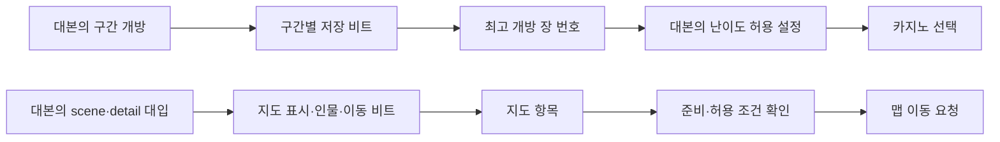

# 14 — 플레이 경험과 설계 학습

## 분석의 목적

파일 수나 해독한 함수 수는 게임 이해의 완료 기준이 아니다. 원작 전체를 플레이어의 입장에서 설명하고, 그 설명을 유메노쿠니의 설계·구현 판단에 사용할 수 있어야 한다. 이 문서는 분석 중 확인한 인과관계와 적용 판단을 유지한다. 모델 자체의 영구 학습을 뜻하지 않으며, 다음 작업에서도 근거와 결론을 다시 사용할 수 있도록 프로젝트에 지식을 남긴다.

각 기능은 **목적 → 화면의 단서 → 입력 → 상태 변화 → 피드백 → 다음 선택**으로 설명한다. 구현 방식과 설계 의도를 구분한다. 코드가 어떤 효과를 만드는지는 확인할 수 있지만 개발자의 의도를 직접 확인한 것처럼 말하지 않는다.

## 현재 이해한 연결과 적용 판단

| 플레이 경험 | 확인한 연결 | 유메노쿠니에 적용할 판단 | 남은 확인 |
|---|---|---|---|
| 장소를 탐색한다 | 자유 위치 이동과 고정 중심 시점 모드가 구분된다. 위치·시점·충돌·조사 ray·화면 마커는 별도 경로다(01·08). | 배경 그림에 핫스폿을 붙이는 것만으로 탐색을 완성하지 않는다. 실제 이동 가능한 공간과 시선, 조사 대상의 우선순위를 연결한다. | 실제 맵의 외형·거리감·가독성·전환 체감 |
| 조사할 것을 발견한다 | ray는 인물과 물체를 구분하고 상태에 따라 반응을 배제한다. 화면 마커에는 투영·거리 조건과 풀 제한이 있다(01). | 모든 대상의 표시 여부와 조사 가능 여부를 같은 bool 하나로 처리하지 않는다. 무엇을 봐야 하는지 안내하는 규칙을 먼저 정의한다. | 가림·겹침·초점 이동의 실제 화면 |
| 대화를 진행한다 | 글자 출력·즉시 표시·다음 대사·자동 진행·스킵은 서로 다른 입력/대기 상태다(02·13). | 확인 입력을 눌렀을 때 아직 출력 중이면 글자를 완료하고, 완료 상태이면 다음으로 가는 식의 상태별 동작을 명확히 한다. | 실제 음성·텍스트·커서의 동기화 |
| 선택 활동을 한다 | 초대의 거절/수락과 완료 플래그, 관계 수치, 선물 선택, 다음 장면 진입이 연결된다(02). | 관계 수치뿐 아니라 시간 소비와 취소·복귀를 구현해야 선택의 비용이 성립한다. | 모든 날짜·인물·진행 제한 및 실제 달력 도달성 |
| 증거를 얻는다 | KTD의 상태 변경·획득 UI·대기·퇴장과 탐색 복귀가 연결된다(03). | 증거 목록 추가와 획득 연출의 완료를 분리한다. 대화 이후 원래 탐색 문맥으로 돌아와야 한다. | 장별 전체 수사 완료 조건 |
| 재판에서 판단한다 | 대본·게임 모드·각 전용 DAT·카메라·입력이 결합된다(04·05). | 동일한 클릭 문제로 모든 논증 방식을 대체하지 않는다. 각 모드가 요구하는 관찰·판단·입력·실패·재도전을 구분한다. | 모든 모드의 조작·판정·채점·실패와 재시도 실제 대조 |
| 정보를 읽고 메뉴를 쓴다 | UI는 계층과 타임라인으로 동작하고 폰트 데이터와 시간 누적 경로가 구분된다(06·11). | 외형과 글자 크기를 맞춘 것만으로 완료하지 않는다. 진입·선택·확정·취소 중 언제 입력이 유효한지 함께 맞춘다. | viewport와 최종 합성, 전환 타이밍 |
| 게임을 중단하고 돌아온다 | 저장 스냅샷·I/O·완료 UI와 장별 재개 진입점이 별도다(00·09). | 대사 번호만 저장하지 않는다. 재개 가능한 문맥과 일관된 저장 완료 시점을 정의한다. | 각 모드에서의 저장 제한·재개 상태 전체 |

이 표의 적용 판단은 분석자의 설계 제안이다. 원작 전체를 직접 플레이해 검증했다는 뜻이 아니다. 상세 native 주소와 증거 ID는 해당 분야 문서를 따른다.

## 이해했다고 판단할 조건

각 모드에서 처음 들어온 플레이어가 무엇을 보고 무엇을 해야 하는지 설명할 수 있어야 한다. 정상 진행뿐 아니라 아무것도 하지 않기·잘못 누르기·취소하기·다시 시도하기·메뉴 열기·저장 후 복귀까지 예상하고 근거로 확인한다. 맵은 방 이름 목록이 아니라 외형·연결·이동·시점·상호작용·진행에 따른 변화까지 연결한다. 미니게임은 파라미터 표뿐 아니라 입력과 판정의 관계를 확인한다.

분야별로 실제 화면 확인이 끝날 때마다 입력 전 상태, 한 번의 조작, 확인된 반응, 정적 분석과의 일치/차이, 남은 질문을 기록한다. 일부 장면만 관찰한 결과를 게임 전체로 일반화하지 않는다.

## 이번에 바로잡은 설계 이해

생성물·기존 저장 캡처도51장/999고유 ID를 실제 열어 확인해 전체 이미지 연락판166장/3,517고유 ID의 축소 구성 검토를 마쳤다. 네 후보를 개별 파일로 더 크게 확인하니 미수집 네모 문자는 `TrialRunner.hpp`의 의도된 치환 정책, 거의 빈 카드는 결번 명세, 우측에 일부만 보이는 문장은 이동 연출과 정합했다. 단일 캡처를 지속 오류로 부르지 않는다. 통신부 표본에서는 인물 발과 하단 안내의 실제 겹침이 보였고 현재 `PdStand`·`PdHint` 배치 경계도 교차했다. 다만 캡처 당시 빌드와 현재 위젯의 동일성·다른 인물·화면비·지속성은 미확인이다. 외부 `human_review_generated_followup.json`에 반증·관찰·한계를 분리했고 현재 게임이나 그림은 고치지 않았다. 기능의 문맥과 합성 결과를 함께 확인해야 단순한 외형 검토가 잘못된 수정으로 이어지지 않는다.

팬게임 source 이미지의 축소 구성 확인은 팀 합계115장 연락판·2,518고유 ID로 확대했고, 원본 경로2,591개를 모두 연결했다. 부모의 배경244 ID, 입상·UI 등1,764 ID, CG·재판 소품510 ID는 서로 중복이나 빠진 번호가 없는지 대조했다. 생성물·실행 캡처의 별도999고유 ID는 이 완료 분모에 넣지 않는다. 흰 배경 입상51개도 그대로 화면에 나오는 것은 아니었다. `tools/game_sprites.py`는 선택된 HD WebP17개를 배경 제거·crop·키 비율·투명 figure 캔버스로 보내며, 대화 portrait는 별도 sprites 경로다. 따라서 소스의 흰 배경만 보고 게임의 흰 사각형 오류라고 단정하는 가설은 기각했다. 다인 포즈도 명세와 연결되는 사례가 있어 상대 인물 존재·실제 장면 적합성을 따로 확인한다. 원본6개 확대는 도구 표시 크기에서의 확인이고 모든 픽셀·모든 게임 합성의 검증은 아니다. 원장은 외부 `native/fangame_visual_review/human_review_*.json`에 보존한다.

팬게임의 정상 참조가 맞는 것과 중단 뒤 같은 문맥으로 복귀하는 것도 별도다. scene14·flow7·trial6 파일의 참조3,336개를 구조 대조해 잘못된 goto/menu 대상·정답 목록 누락·구간 범위·무입력 goto 순환은 발견하지 못했지만, 같은 인스턴스에서 패드→타이틀→새 게임 경계에는 이전 `after`와 `eventEnd`가 남을 수 있었다. `Flow.hpp`의 `newGame/openChapter/toTitle`은 이 두 필드를 초기화하지 않고 `advanceFlow/flowPresent`는 계속 소비한다. 따라서 조사 구간의 종료 상한이나 선물 반응 뒤의 활동 완료가 새 장면에 적용될 수 있는 조건부 경로다. 외부 `native/fangame_static_consistency_audit.json`의 CONTEXT-01에 현재 데이터 표본·필드 쓰기·반증 경계를 보존했다. 실제 실행으로 재현하거나 수정한 결과는 아니며 기존 SAVE-01과 중복 집계하지 않는다. 원작을 따라 만들 때도 정상 정답 진행뿐 아니라 중단·취소·재시작의 문맥을 분리해 검증해야 한다.

팬게임 자체 배경244개도13장 연락판의 모든 번호를 직접 확인했다. 호텔·개인실·유원지·기술 구역의 형태와 색조를 파악했지만, 축소판 확인을 원본 해상도 품질이나 실행 중 조사 가독성의 승인으로 세지 않는다. 일반 호텔 복도와 층별 복도의 표현 차이가 보여 소비 경로를 대조하니 `tools/build_flow.py:27`의 일반 복도 규칙과 여러 장의 `data/flow`가 `hotel_corridor`를 실제 참조했다. 그림이 존재하는 것과 알맞은 장소·상태에 선택되는 것은 별도라는 사례다. 어두운 실내의 조사 대상, 가까운 재판 배경에 이미 포함된 책상과 별도 레이어의 겹침은 실행 확인 대상으로 남긴다. 외부 `native/fangame_visual_review/human_review.json`은 실제 본244개와 아직 보지 않은 다른 component·생성물을 구분하며 그림을 바꾸지 않았다.

옵션은 표시 이름보다 실제 소비를 확인해야 한다(09·13). 지도 설정은 지도 전체를 숨기는 토글이 아니라 지도와 방향 화살표의 회전 방식을 바꾼다. 글자 속도는 남은 글자의 표시 갱신에 적용되며 자동 진행 대기 시간과 같지 않다. 옵션 화면 취소에는 변경값 복원이나 자동 저장을 확인할 수 없었고, 기본값 복원은 음성 언어를 제외한11필드와 음량 API의 재적용을 수행한다. PC config의 키 설정도 파싱과 실제 입력 행렬에 적용하는 단계가 별도다. 팬게임의 옵션에는 바뀌는 대상·적용 시점·취소와 저장 정책을 명시하고 실제 효과를 검증해야 한다. 원작의 모든 옵션 화면을 직접 조작한 결과는 아니다.

메뉴를 열 수 있는 조건, 저장 항목을 선택하는 조건, 비동기 저장 성공은 각각 다르다(09·21). 재판 하위 모드 일부는 패드 객체를 없앴다가 복귀 시 다시 만들고, 다른 모드는 객체를 유지하면서 열기 조건을 막는다. System 공개 검사를 통과해 저장 선택에 도달하는 경로와 저장 작업의 완료·성공 결과도 나뉜다. 팬게임에서는 화면에 저장 항목을 그리는 것과 안전한 재개 문맥을 준비하고 저장 성공을 알리는 것을 하나의 상태로 묶지 않는다. 실제 파일 쓰기·클라우드 동기화 완료를 관찰한 결과는 아니다.

레벨 표에 체력·집중 열이 있어도 실제 최대치에 그대로 연결됐다고 가정하지 않는다(19). 확인한 실행 코드의 경로는 별도 저장 기본값과 장착 스킬로 최대치를 구하고, 현재값의 피해·회복·집중 소비를 처리한다. 또한 같은 스킬도 논스톱과 브레인드라이브의 유지 비용·회복 계산이 다르다. 팬게임에서는 성장 표·최대치·현재값·모드별 소비를 구분해야 한다. 표의 power/mental getter와 실제 최대치의 연결은 미확정으로 유지했고, 레벨 표를 그대로 적용하자는 이전 구현 제안도 바로잡았다.

탐색의 발걸음 소리는 충돌 처리 뒤 실제 이동 거리를 다시 재는 방식이 아니라 속도 기반 위상의 경계에 연결된다(01·07). 정지할 때 위상이 중립으로 돌아오며 마지막 소리를 한 번 요청할 수도 있고, 시점 흔들림을 끄는 옵션이 이 소리를 함께 끄지는 않는다. 표면 분류 코드가 있어도 현재 수동 이동의 solver 설정에서는 해당 후처리가 실행되지 않아 기본 index 경로를 쓴다. 팬게임에서는 걷기 소리·시점 흔들림·충돌 후 변위의 관계를 각각 정하고, 표면 이름이나 공용 함수의 존재만으로 실제 동작을 가정하지 않는다. 벽을 향해 걸을 때의 실제 발소리나 청취 결과를 검증한 것은 아니다.

마우스도 화면의 겉모습만으로 좌표를 환산하면 안 된다(13). native는 swap-chain backbuffer와 display-color target의 실제 크기를 읽고, 비율이 다른 경우 중앙 여백을 제거해 게임 좌표로 바꾼다. 그 다음 현재 위치·이동량·재중앙화·미니게임별 배율·판정이 분리된다. 두 이동량 getter가 서로 다른 필터라는 추정은 같은 필드 복사라는 원시 근거로 기각했다. 팬게임에서는 창과 내부 표시 크기, 여백, HUD의 좌표계와 실제 판정점을 연결해야 조준점과 클릭 위치가 어긋나지 않는다. 실제 장치 지연과 모든 미니게임의 배율을 관찰한 것은 아니다.

공간의 외형은 메시가 있다는 사실만으로 설명되지 않는다. 교실의 wall/desk/blackboard 텍스처3개를 직접 열어 보니 여러 방향의 책상·의자 그림과 창·커튼·소품이 atlas에 묶여 있다. 이는 방 전체의 완성 배경 그림과 다르다. 어떤 그림을 어느 면에 붙이고 어떻게 배치하는지는 UV·재질·노드 변환을 더 연결해야 한다. 아직 완성 scene을 복원하거나 실제 원작 화면을 확인했다고 하지 않는다. 팬게임에서도 먼저 평면 소품과 입체 기하가 맡는 역할을 확인한 뒤 자체 그림의 제작 단위를 정한다.

이론 무장의 통상 리듬 판정에서는 실수 하나가 체력을 바로 깎는 것과, 텐션이 줄어0이 되었을 때 체력 피해로 이어지는 것이 구분된다. 상대 체력을0으로 만든 뒤 마지막 문제를 틀리면 상대 체력이 일부 회복되고 내부 리듬 단계로 돌아간다(05). 전체 실패·WRD 재시도와 다른 피드백 고리다. 미니게임을 공통 정답/오답 팝업 하나로 구현하면 이러한 긴장과 회복 기회가 사라진다는 적용 판단을 얻었다.

패드 지도도 장소 이름을 고르는 것만으로 이해하지 않는다. native에는 구역 전환, 최대6행 목록의 선택·스크롤, 인물4×4 선택, 장소의 표시·확정 허용 조건, 퇴장 연출 뒤 이동 목적지 반환이 나뉜다(15). 장소 그림의 좌표와 이동할 맵/시작 위치도 별도 자료다. 팬게임에서는 인물을 찾은 결과와 장소 선택·이동을 같은 공간 자료에 연결해야 한다. 실제 화면에서의 합성과 조작 체감은 아직 확인하지 못했다.

발굴 이매지네이션의 되돌리기는 제거한 그룹과 경계 색을 복구하지만 시간·체력을 환급하지 않는다(05). 집중 상태도 일반 제거·제출을 받는 상태와 구분되고 시간은 계속 소비된다. 그러므로 이름이 비슷한 보조 기능을 모든 미니게임에서 같은 시간 감속 기능으로 만들지 않는다. 모드별로 무엇을 도와주고 어떤 비용을 유지하는지 확인한다.

입력은 키 이름보다 행동과 상황으로 정의해야 한다. 타이틀에서 Enter를 받는다고 모든 화면의 확정이 Enter인 것은 아니다. 탐색의 조사 입력도 조작 모드에 따라 허용 조합이 다르다. 물리키→논리 행동→상태의 허용 여부를 나눠야 조작 도움말과 실제 동작이 맞는다(13).

UI의 정지에도 범위가 있다. 부모 타임라인의 Stop 뒤에도 자식 레이어 업데이트가 이어질 수 있지만, 플레이어 전체 freeze/paused는 진입 자체를 막는다. 따라서 메뉴가 입력을 기다릴 때 자식의 점멸이나 반복 연출을 유지하는 것과 화면 전체를 멈추는 것을 구분해야 한다(06). 이는 코드 구조에서 얻은 설계 해석이며 모든 원작 메뉴의 실제 점멸을 관찰했다는 뜻은 아니다.

글자 모양과 진행 속도도 별개다. 기존에 크기 후보로 봤던32/16은 타임라인 진행량이고, 실제 text 높이는 SFL text 헤더와 폰트 배율 경로에서 결정된다. 글자 간격·수평 정렬·개행·부모 좌표 변환을 연결해야 최종 읽기 경험을 재현할 수 있다(06).

개별 미니게임에서는 아무것도 맞히지 않은 입력과 실제로 틀린 대상을 선택한 입력을 구분한다. 애너그램의 선택 마스크 밖 클릭, 특수 글자 선택, 정상 글자의 정답 비교는 서로 다른 경로다. 선택이 들어온 순간의 판정과 글자가 도착한 뒤의 비교도 분리되어 있다(05의 추적 결과를 따른다). 팬게임에 적용할 때는 클릭 즉시 성공/실패로 끝내는 방식이 이 차이를 지우는지 검토한다.

브레인드라이브는 차량과 답안 대상의 공간 충돌이 답 선택으로 이어진다. `0x1400f8030`은 활성 대상의 충돌을 확인한 뒤 answer.dat의 결과 열을 조회하고, 빈 결과에는 피해 보정·체력 차감, 유효 결과에는 탑승 연출·경로 기록을 연결한다. 따라서 논리적으로 정답을 고르는 기능이 같아도 일반 텍스트 메뉴로 바꾸면 이동·주목·선택을 동시에 수행하는 플레이가 사라진다. 근거 `ev_fb3c269feba6514514b81791a9c7e4b4578793acfa015f251aa9e26ae6def4e2`, 결과 열 getter `ev_a0a69f385ba60d95833806414dded785b2fb74c82a24c540b13899a2bc54b464`. 전체 모드의 채점·복귀·모든 조작 검증은 계속 진행 중이다.

맵은 교실·복도·야외 대표3개의 좌표 분석 그림을 직접 대조했다. 이 그림은 원작 화면·배경 복제가 아니라 지면으로 분류한 충돌면과 배치 좌표의 투영이다. 야외 표본의 충돌면은 띠처럼 연결된다. 다만 그 투영을 실제 이동 허용 영역과 동일시하지 않는다. 전체 경계 상자도 지면 투영 mask도 중력·높이 유지·벽 접촉 소비를 확인하기 전에는 원작의 동선 규칙으로 확정할 수 없다. 교실의 책상·의자처럼 노드에 연결된 대상은 별도 XYZ가0이어도 모두 원점에 겹쳐 있다는 뜻이 아니다. 부모 변환을 따라야 한다. 복도 일부 시작점과 충돌면의 좌표 불일치는 강제로 가까운 면에 붙이지 않고 미확정으로 유지했다(01).

음악 전환도 플레이 경험의 일부다. BGM은 두 재생 슬롯을 이용해 새 곡의 음량을 올리거나 이전 곡을 함께 내린다. 일시정지는 재생 객체뿐 아니라 페이드 카운터도 멈추며, 동일 곡 유지와 곡 변경은 대본의 별도 조건을 거친다(07). 팬게임에서 장면 이름만 보고 음악을 갈아 끼우면 대사·선택·침묵 사이의 연결이 달라질 수 있다. 전환 이벤트와 pause·stop·동일 곡 유지 정책을 시나리오 상태에 연결해야 한다. 실제 최종 믹싱을 청취해 검증한 것은 아니다.

카지노도 공통 보상창 하나로 묶지 않는다. 물고기·발굴·주행은 시작 전 베팅 차감과 종료 확인 시 정산을 공유하지만, 슬롯은 최대7개 라인의 베팅·라인별 지급·추가 차감 없는 무료 판이 별도로 연결된다(10). 플레이어가 어떤 선택으로 비용을 확정했는지, 취소하면 비용이 남는지, 재도전이 가능한지까지 포함해야 규칙을 이해한 것이다.

스크럼의 두 단계는 요구하는 판단이 다르다. 먼저 상대 발언과 짝을 연결하고, 전체 짝을 해결한 뒤에는 방향 입력 단계로 넘어간다. 후반 실패에는 단계 후퇴가 있으며 첫 단계에서의 실패와 전체 완료가 다른 결과로 돌아간다(05). 따라서 모드 이름이나 승리 화면이 같아도 두 단계의 안내·입력 허용·실수 피드백을 각각 설계해야 한다.

수동 탐색에서는 일반 물리 solver에 있는 기능이 전부 켜지는 것이 아니었다. 실제 호출이 설정하는 flag 때문에 일반 침투 보정·다중 접촉 제약·표면 분류는 건너뛰고, sweep의 안전 전진과 접촉 법선에 따른 XYZ 속도 보정을 사용한다(01). 기본 반경0.5·높이1에서는 충돌 중심 두 개가 같아 구형으로 퇴화하지만 눈높이는1.5로 별도다. 팬게임에서 인물의 외형 높이·시점 높이·충돌체 높이를 하나로 정하면 원작의 이동 감각과 다른 결과가 날 수 있다. 이 사실을 원작의 meter 단위나 모든 카메라 모드의 같은 충돌 설정으로 일반화하지 않는다.

맵 검토 분모도 넓혔다. 전체 Map 라벨164개 중 직접 bg 연결142개와 미연결22개를 구분했고, 연결142개 전부의 좌표 연락판8장을 직접 검토했다. 여기서 본 것은 COL XZ·시작점·인물slot·물체좌표다. COL이 없는89개 공간은 점의 배치만 보여 주므로 방의 벽·가구 외형을 보았다고 세지 않는다. 실제 모델의 입체/평면 기하와 최종 표시를 다음 층으로 연결한다. 좌표·정적 외형·실제 플레이 관찰이라는 서로 다른 증거를 합쳐 '전체 맵을 플레이했다'고 하지 않는다.

탈출 모드는 선두의 입력 기록을 뒤따르는 캐릭터들이 지연해서 읽으면서 각자의 접촉·탈락을 처리한다(17). 선두가 빠지면 입력 대상과 시점을 바꾸고 생존 수0에서 전체 실패를 낸다. 따라서 일행이 많아도 한 캐릭터의 장식용 잔상으로 대체할 수 없으며, 조작 대상 교체와 남은 기회의 의미가 있어야 한다. 성공/실패 결과를 본편에 전달할 때도 연출·정리 뒤 복귀라는 경계를 유지한다.

본편의 성장은 큰 사건을 끝낸 보상만으로 이루어지지 않는다. 이동의 보행 경계, 유효한 조사·대화, 물체 반응, 집중 진입에 작은 경험치 보상이 따로 연결되고 대본의 명시적 보상도 존재한다(19). 이 구조에서는 공간을 살피고 사람에게 말을 거는 행동도 누적 성장에 기여한다. 팬게임에 적용하려면 메뉴를 열거나 매 프레임 갱신하는 시점이 아니라 실제 행동이 성립한 경계에 보상을 연결해야 한다. 다만 원작의 모든 반복 지급 방지 조건·최종 능력치 소비·레벨 상승 화면은 아직 확인 중이므로, 작은 보상 구조의 설계 해석과 실제 전체 플레이 검증을 구분한다.

전체 맵142개에 대해서는 기하 연락판에 이어 텍스처 참고뷰9장도 직접 검토했다. 이로써 방의 장식·재질과 벽·가구·통로의 관계를 좌표만 볼 때보다 구체적으로 파악했다. 하지만 한 장의 자동 참고뷰가 방 전체를 잘 보여 주지는 않았다. 벽이나 문에 붙은 시점, 거의 검게 나온 시점, runtime 가시성·shader 미재현 때문에 큰 평면이 가리거나 회색 공백이 생긴 예가 있었다. 따라서 생성142/142를 전체 외형 이해 완료로 바꾸지 않고 저정보 시점의 보완 대상으로 남긴다. 일부 유사 맵은 payload와 카메라가 모두 같아 동일 뷰를 재사용한 것이므로 별개의 플레이 관찰 수로 늘리지 않는다.

레벨 상승은 저장값을 고친 순간과 알림이 끝난 순간도 구분된다. native에서는 표시 레벨과 실제 레벨의 차이를 감지하고 알림 진입·효과음·UI 완료를 기다린60회 카운트·퇴장을 처리한다(19). 팬게임에서 보상을 여러 번 받았다고 중간 레벨마다 팝업을 무조건 중첩하면 이 상태 경계와 달라질 수 있다. 실제 화면을 확인하기 전에는 이 카운트를 초 단위나 팝업의 최종 크기로 환산하지 않는다.

별도 일상에서는 본편 자유행동의 규칙을 재사용한다고 가정하면 안 된다(20). 날짜·활동 슬롯·초대 대상 선정·장소 선택·각 선택 결과 보상·마음 논파·저장 재개가 독립해서 연결돼 있다. 초대는 전체 인물의 가중치를 한 번 추첨하는 방식이 아니라 인물별 통과 여부를 먼저 뽑고 통과한 목록에서 한 명을 고른다. RNG 범위와 비교 연산 때문에 명목50과 실제51/100도 구분된다. 팬게임의 관계 시스템을 확장할 때는 표시 숫자나 기능 이름만 복사하지 않고, 플레이어가 활동을 소비하는 경계와 상대가 선정되는 규칙을 명시해야 한다. 모든 인물의 대본 분기와 실제 실행을 완주한 것은 아니다.

애니메이션의 반복과 정지도 구체적인 동작 경계가 있다(12). 이동·크기는 선형으로, 회전은 최단 반구 SLERP로 보간하며, 반복 모드 중에는 끝을 넘은 시간을 버리고 처음으로 돌아가는 경로가 있다. 시간을 멈추는 모드0에서도 별도의 페이드 잔여 시간은 줄어든다. 팬게임에서 모든 반복에 나머지 시간을 보존하거나 정지 때 페이드까지 일괄 정지시키면 원작의 포즈 전환·겹침과 차이가 생길 수 있다. 각 채널의 실제 대상과 전체 GPU 스키닝까지 확인한 것은 아니므로 이 결과를 모든 인물 표현의 완성 규격으로 쓰지는 않는다.

카드 수집의 보유 기록과 육성 결과 등록은 서로 다른 상태다(10). 뽑기에서는 먼저 보유를 갱신하고 비용·중복 보상을 반영한 뒤 저장 스냅샷을 준비하며, 저장 실패의 Retry는 다시 추첨하거나 비용을 재차 쓰는 경로와 구분된다. 팬게임에서도 결과 연출과 실제 재화·보유 상태를 분리하고, 저장 재시도가 보상을 중복 지급하거나 비용을 중복 차감하지 않게 해야 한다. 표의 가중치와 정수 난수의 경계 처리도 달라 명목 수치를 그대로 확률로 표시하지 않는다. 실제 뽑기 플레이와 저장 성공을 관찰했다는 뜻은 아니다.

음악에 반응하는 HUD는 소리를 재생하는 기능과 따로 연결돼 있다(07). 원작은 현재 BGM의 재생 위치를 VIS 레코드로 바꾸어8개 목표값을 얻고, 화면 표시값은 상승과 감쇠에 서로 다른 규칙을 쓴다. 따라서 음악 재생과 무관한 랜덤 움직임이나 일정한 점멸을 붙이면 같은 피드백이 되지 않는다. 팬게임에서는 자체 음원에서 자체 반응 자료를 만들고, 재생 위치·루프·표시 상태를 연결하는 설계를 검토한다. 이8개 값을 주파수 대역이나 리듬 판정이라고 확정하거나 실제 원작 화면을 검증한 것으로 부르지는 않는다.

## 실행 관찰 시작 — 2026-10-26

본편 도입 실행에서는 일반 공간 대화의 색 테두리·상단 위치/진행 HUD와, CG/암전 위의 단순한 하단 대화 표시가 서로 다르게 나타났다. 내적 서술은 푸른 외곽선 글자, 일반 발화는 흰 글자로 보인 표본이 있고 화자 이름 표시도 장면에 따라 생기거나 비었다. 따라서 배경 교체만 하고 대화창·상단 HUD를 항상 고정하는 방식은 이 표본의 레이어 전환을 재현하지 못한다. 이는 도입 구간에서 직접 본 차이이며 전 장의 색 규칙·접근성·글꼴·픽셀 치수·정확한 지속시간을 모두 확정한 것은 아니다. 별도 사선 인물 패널의 표정이 바뀌어도 공간 속 주 인물과 배경은 유지되는 장면을 확인했다. CG·대사 내용은 옮기지 않는다.

**23:17:39 UTC 가까운 대화 화면 후속:** 공간의 전신 배치에서 가까운 인물 화면으로 넘어가고 사선 보조 인물 패널이 겹치는 것을 관찰했다. 같은 제한 숫자 표본의 마지막 제출 eye `(0.623149,1.95,0.930706)`·yaw-190·pitch0·수평 FOV35는 CameraState1과 일치했다. slot0은 기본 orbit/FOV70을, slot2는 앞선 FOV45 값을 유지했다. 따라서 여러 slot에 유효해 보이는 값이 남아 있어도 모두 현재 화면의 카메라라고 부를 수 없다. 근거는 외부 `runtime_gameplay_snapshots.jsonl`의 해당 UTC 표본이며45회/274바이트 읽기 오류0, auto0이었다. 정확한 활성 preset·최종 효과 전체·자유 이동은 미확인이다. 화면의 대사·원작 그림은 문서에 옮기지 않았다.

팬게임 음원도 파일과 실제 소비 경로를 대조했다. 원본 OGG194개와 생성본194개는 각각 SHA가 같고, 기본137큐·도입부57개·오디오 에셋194개에서 누락·0바이트·오디오 디코드 오류가 없었다. 이는 청취 품질의 합격 판정은 아니다. 외부 `native/fangame_audio_review.json`은 전체 파일 반복4개의 후미 저진폭 구간과 BGM11개의 경계 불연속 수치를 청취 후보로만 보존한다. `Flow.hpp`의 `Audio::PlayMusic(...,1.f)` 두 번째 인수는 반복 여부가 아니라 페이드 초이며, 엔진 `Game.hpp:99`·`Session.hpp:49`·`prototype/engine-services.js:451,455`에서 BGM 반복과 이전 곡 페이드아웃·새 곡 페이드인을 확인했다. 따라서 '팬게임 엔진에 반복·크로스페이드가 없다'는 일반화는 기각한다. 남은 비교는 원작 대본의 전환 경계·동일 곡 유지·도입부 연결·정지 정책과 실제 출력이다. 이번 대조는 파일 읽기와 파형 수치 검사이며 실제 청취·게임 실행 검증은 아니다.

**22:51:42 UTC 카메라 후속 관찰:** 같은 요청 맵18과 기본 orbit 위치를 유지한 채, CameraState0·1은 기본 eye `(-1.413307,2,2.340481)`·yaw-190·pitch1.8·수평 FOV70을 가졌다. 그 시점에 마지막 제출된 eye `(-2.756484,1.7,-1.647167)`·yaw186.658997·pitch0·수평 FOV45는 CameraState2와 일치했다. 그러므로 place의 기본 FOV70이나 slot0만 읽어 현재 대화 화면의 시야라고 해석하면 틀린다. 정확한 활성 preset·최종 카메라 효과 전체·수동 조작은 여전히 미확인이다. 기본 orbit의 파일→코드→수치 대조는01의 label18 실행 표본 절에 연결했다.

**22:31:36 UTC 추가 관찰:** CG 이후 실제 공간 배경과 일반 대화창이 함께 표시됐다. 같은 시점의 숫자 표본에서 탐색 마지막 제출 eye `(1.713474,1.386011,-5.162232)`와 CameraState slot0 eye가 같았고 yaw157.375854·pitch4.319824·수평 FOV70이었다. 요청 맵은18을 유지했다. 이는 앞선 도입의 제출값0 상태에서 달라진 실행 근거다. 아직 대화 중이므로 실제 보행 입력·충돌·조사 가능 상태, 최종 카메라 효과 전체를 검증했다고 하지 않는다. 22:33:03 UTC의 E1회 뒤 표본도 auto0이었으며 화면의 자동 진행 활성화는 확인되지 않았다.

도입 대화에서는 빈 화면 영역의 단일 마우스 클릭으로 다음 대화가 나타나는 것을 반복 확인했다. 즉시 캡처가 이전 문장을 담고 뒤의 재관찰에서 다음 문장이 보인 경우도 있어, 즉시 화면이 같다는 이유만으로 입력 실패라고 판정하지 않는다. Space와 E를 각각 한 번 보낸 뒤의 제한된 읽기 전용 표본에서는 auto bit가0이었다. 기본 키 연결의 정적 확인과 현재 실행에서의 입력 수신 성공을 구분한다.

22:21:12·22:21:48 UTC 표본은 원본 경로·SHA를 검증한 뒤 숫자 필드만45회/274바이트 읽었다. scene/submode1/1, 요청 맵18, auto0, 세 대화 gate0, 탐색의 마지막 제출 시점·위치값0이었다. 화면은 여전히 도입 대화이므로 요청 맵18을 실제 보이는 탐색 맵, 기본 카메라 값을 현재 렌더링 시야로 해석하지 않는다. 실제 보행·시점 조작은 미확인이다. 외부 원장 `native/runtime_gameplay_snapshots.jsonl`과 `gameplay_probe_fields.json`에 주소의 근거·읽기 오류·비원자적 표본 한계를 보존했다.

**07시대 새 게임 진입 관찰 — 이전 Load 대기보다 우선:** 원본 PID43200을 Alt+F4로 정상 종료하고, Steam 라이브러리에서 V3의 정체된 시작 요청을 취소한 뒤 플레이→공식 실행 선택의 플레이로 다시 열었다. 새 원본 PID25660/Sky창988378에서 타이틀을 확인했다. 탐색기/Steam의 element index 클릭은 선택만 보이거나 기대한 실행이 안 된 사례가 있어, 최신 screenshot에 근거한 좌표 입력으로 결과를 다시 확인했다. 이를 원작 게임 자체의 일반적인 오류로 분류하지 않는다.

새 타이틀에서 drag1회로 초기3항목 진입, wheel up1회로 NEW GAME의 밝은 선택 표시 확인, 빈 곳 click으로 현재 선택을 확정했다. 데모 저장 자료 가져오기 질문에서는 wheel1회로 No를 밝게 선택한 뒤 확정했다. 음성은 기본 Japanese를 확정했고, 이어 실제 메인 메뉴의 새 게임·잠긴 항목·옵션·Extra 구성을 관찰했다. 새 게임 진입 뒤 논리/액션 각각 Normal인 난이도 화면에서 wheel2회로 행 선택→GAME START를 밝게 선택하고 확정했다.22:13:31 UTC에는 로딩 이후 시작 영상이 실제 재생되는 것을 관찰했다. 영상 내용·대사는 이 문서에서 옮기지 않는다. 전체 영상 길이·정확한 프레임·소리 출력·본편 보행·전 장 플레이를 검증한 것은 아니다. 슬롯 저장·덮어쓰기·삭제는 하지 않았다. 예전 Load 화면에서의 물리 Esc 비교 질문은 해당 프로세스를 닫았으므로 더 이상 그 화면의 진행에 필요하지 않다.

**추가 목록 입력 관찰(21:48:08~21:49:06 UTC):** Sky로 새 화면을 확인했을 때 Load 목록의 Free Slot1이 선택돼 있었다. 목록 안(1710,520)에서 `scrollY600`을 한 번 보낸 직후 Free Slot2로 밝은 선택 테두리가 이동했다. 도구의600을 게임 내부에서600행/5칸 이동했다는 뜻으로 해석하지 않는다. 이 관찰은 목록의 모든 입력이나 UI 준비가 영구히 막혀 있다는 설명과 맞지 않는다. 키보드 취소가 실패한 원인까지 해결한 것은 아니다. 저장·불러오기 확정·삭제는 하지 않았다. 이어21:49:20 UTC에 읽기 전용 상태 mode1/title controller23·scheduler513605를 확인했다. 정확한 UI 행동 UTC는 별도로 계측하지 않았으므로 위 구간만 기록한다.

**06시대 실행 관찰 갱신:** 원본 PID43200의 입력 manager +0xa0/+0x1c가 모두1이고 mouse 포인터가 존재하는 것을 읽기 전용으로 확인했다. Sky에 문서화된 drag를 타이틀의 빈 공간(220,800)→(520,800)에 한 번 수행하자 PRESS ANY BUTTON이 사라지고 NEW GAME/LOAD GAME/QUIT 선택 화면을 실제로 관찰했다. 타이틀의 입력 전체가 막혔다는 설명은 이 관찰로 반증됐다. 도구 wall time1.1초를 정확한 누름 유지 시간으로 환산하지 않는다. 앞선 짧은 키 press 실패의 원인은 아직 미확정이다. 사용자에게 물리 키보드Z 비교 답변은 이제 필요하지 않다고 알렸다.

이어 NEW GAME 화면 위치를 대상으로 한 클릭을 시도했지만, 실제 후속 화면은 **Load 목록**이었다. 클릭 직후 캡처와 다음 Up1회 뒤 캡처 사이에 전환이 진행됐으므로, Up이 Load를 열었다고 단정하지 않는다. 당시 선택은 LOAD GAME이었고 화면의 게임 커서가 목표 위치까지 즉시 이동하는 모습도 아니었으므로, UI 위의 좌표 클릭과 해당 위치의 항목 확정이 항상 같은 동작이라는 추정을 보류한다. 최종 목록에서 Free Slot1..6과 스크롤·날짜 표시 전환 안내를 관찰했다. 이 여섯 칸을 전체30슬롯이 비어 있다는 증명으로 바꾸지 않는다. Escape1회 뒤에도 목록을 관찰했으며 정상 취소를 확인한 것으로 세지 않는다. 슬롯을 저장·덮어쓰기·삭제하지 않았다.

21:10:07 UTC의 읽기 전용 상태는 여전히 mode1이지만 타이틀 controller +0x54가8에서23으로 바뀌었다. 새로운 하위 UI와 상위 모드가 다른 층이라는 실제 사례다. 키보드 서버 등록 수1·장치 포인터 존재·현재/이전/새누름/해제/반복 population0도 확인했다. 키의 내용은 보존하지 않았다. 0이라는 값만으로 조회 실패와 무입력을 구분할 수는 없다. 실제 context vtable +0x178은 RVA49dad0이고 정적 원시 코드에서670360→5bec30 폴링으로 연결됐다(13). 아래의 입력 대기8 기록은 이 전환 이전의 이력이다.

**04:27 이후 관찰 갱신:** 추가 원본 실행에서는 초기 안내와 PRESS ANY BUTTON 타이틀을 실제로 관찰했다. 앞선 검은 화면의 원인이 해결됐다고 단정하지 않으며, 아래 검은 화면 기록은 이전 실행의 이력이다. 19:27:31 UTC의 프로세스43200은 UI22개 ready, 그래픽 device/context/swapchain 포인터 non-null이었다. 원본 화면 표시 자체를 이번에 확인했다는 것이고 실제 FPS·전체 메뉴·본편 맵 검증은 아니다.

읽기 전용으로 현재 타이틀 UI ID10개와 ready값10개가 연속하는 정확한 구조를 제한된 쓰기 가능 heap영역에서 찾았다. 일치 후보는1개이고 +0x54 상태8이었다. 이는 정적 controller의 입력 대기와 일치한다. 프로세스 쓰기·주입·디버거 부착은 하지 않았다. Sky의 Z·클릭·Return 뒤에도 이 대기가 유지됐다. 입력 게이트 +0x1e2c=1/+0x1e30=0도 관찰했다. 실제 키보드로 Z를 눌렀을 때의 반응을 주인님에게 별도로 질문했으며, 입력 문제를 원작 게임 전체의 조작 설계로 일반화하지 않는다. 이 실행의 캡처는 도구가 보여 준 화면이며 원작 이미지를 저장소에 복사하지 않았다.

주인님은 이 설치본을 아직 직접 실행한 적이 없다고 답했다. 이전에 정상 화면이 나온 동일 설치본이라는 baseline은 확보되지 않았다. 사용자에게 같은 실행 이력을 다시 묻지 않고, 아래 관찰 범위와 별개로 정적 분석을 계속한다.

Windows `computer-use`의 Sky로 원본 실행 파일을 실행했다. Steam 실행 선택 창과 게임 창, 검은 배경 위 게임 커서를 관찰했다. Return/Escape에 메뉴 화면이 나타나지 않아 본편 플레이 검증으로 집계하지 않는다. 창을 정상 종료했다. 실행 과정에서 게임 자체가 설치 폴더에 config.txt를 생성했다. 수동으로 설치 자산·저장 자료를 편집하지 않았다.

Sky의 직접 실행으로 연 공식 런처는 현재 작업 폴더가 WindowsApps가 되어 config 접근 오류를 표시했다. 그 오류는 게임의 설계나 일반적인 실행 불능의 증거가 아니다. 오류를 닫고 기존 탐색기의 설치 폴더에서 V3Launcher.exe를 선택해 실행하자 정상 제목의 런처 창이 만들어졌다. 이후 실제 메뉴·맵·조작 관찰을 이어간다. 정적 복원 EXE는 실행하지 않았다.

정상 런처 화면에서는 Windowed, Window Size 1920×1080, Graphics High, Resolution 1920×1080(비활성), FXAA, Help Type Gamepad를 직접 확인했다. 옵션을 바꾸지 않고 Start Game→Steam의 Play를 선택했으나 본체는 다시 검은 화면과 커서에 머물렀다. 기본 확정 키 Z에도 메뉴를 관찰하지 못했다. 이 재현 때문에 최초 검은 화면을 잘못된 작업 폴더 때문이라고 확정하지 않는다. 본편 진입 실패 원인은 미확정이다. 두 번째 본체도 정상 종료했다. 게임 실행 관찰과 원본의 맵·본편 플레이 검증을 구분한다.

자유행동의 일반화도 정정한다. 일부 수락 완료 분기는 다음 scene으로 진행하지만 같은 scene으로 돌아오는 예외가 존재한다(02). 따라서 시간 슬롯은 완료 플래그만으로 고정 횟수를 추정하지 않고, 호출자의 분기와 실제 다음 진입점을 확인한다.

세 번째 실행에서는 원본 모듈의 경로·SHA를 확인한 뒤 ReadProcessMemory의 읽기 권한만으로 알려진 초기 상태값을 관찰했다. 2026-10-25 18:27:55 UTC(한국 26일03:27:55), 선택 언어는2(US), 초기 준비 상태는3, 부팅 설정은0이었다. 18:28:46 UTC에는 같은 값과 현재 모드1을 확인했다. 초기 resident 준비 대기에 머물렀다는 가설은 이 관찰에서 반증됐다. 모드1 도달과 타이틀 내부 UI 준비 완료는 별개이므로, 실제 메뉴 표시까지 완료했다고 간주하지 않는다. 상세 숫자와 읽기 방식은 외부 `native/runtime_boot_snapshots.jsonl`, 재현 소스는 `native/read_boot_state.py`다. 프로세스 쓰기·코드 주입·디버거 연결은 하지 않았다.

이후 같은 프로세스의 scheduler tick은29.589초 동안1,776회 증가했다. 이는 이 구간에서 약60tick/초가 관찰됐다는 뜻이며 GPU의 실제 표시 FPS와 같다고 하지 않는다. UI400슬롯 중22개가 존재하고 전부 ready였다. 타이틀7개 루트 커서는 각 원본 SFL의 Stop 프레임과 정확히 일치했으며, 전체 player freeze/paused는0이었다. 일반 fade도 실제60/60 진행값과 표시 계산을 대조해 alpha0/비표시 상태를 확인했다. 따라서 초기 로딩·전체 tick 정지·그7개의 비정상 root 정지·일반 검은 fade로 현상을 설명하는 가설을 제외했다. Z 한 번 뒤에는 해당 UI 커서 변화가 관찰되지 않았다. 타이틀 내부 상태와 입력 수신·그리기의 구분은 계속 남는다.

공식 런처의 Graphics를 High에서 Medium으로만 바꿔 비교했다. 런처는 창1920×1080을 유지하면서 config의 내부 render_size를1280×720으로 바꿨다. 그 실행도 검은 화면이었고, 언어2·준비상태3·모드1·UI22ready 및 keyboard 객체 non-null을 관찰했다. 정상 종료 후 런처에서 High로 복원해 저장했고, 비교 전 config와 모든 설정 필드의 차이가0임을 검사했다. 불필요한 재실행 요청은 Steam에서 취소했다. 설치 자산·세이브·실행 메모리를 수정하지 않았다. 이 비교로 다른 모든 표시 설정의 원인을 배제했다고 일반화하지 않는다.

## 도입부 학습: 대화 종료와 조작 허용을 별도로 증명

도입부6개 캐시 파일의 명시적 전환을 네이티브 소비와 대조했다. `c00_001_018`의 FIL 뒤에 탐색 명령이 있다고 해서 그 위치가 다음 실행점인 것은 아니다. FIL은 현재 깊이의 파일을 교체하며 실제 사슬은 `002_000 → 002_018`로 이어진다. 첫 시점·조사 선택 대기 후보는 `002_018@374`다. 안내 조건의 양쪽은 각각 BTN13개이고 같은 label로 합류하지만, 이 수는 실제 남은 입력이나 시간 예측값이 아니다. 명령 파싱·정적 분기·실행 현재 위치를 각각 증명해야 한다.

또한 `modTansakuWait`는 준비 gate를 거쳐 WRD 대기 bit·복귀 위치·탐색 manager·controller 상태를 연결하는 요청이다. 화면 요소가 보이는 것, 이 요청을 실행한 것, 정상 조작 준비 predicate를 충족한 것, 실제 선택 성공은 같은 증거가 아니다. 같은 공간도 대화 카메라와 수동 시점을 나눠야 한다. Map18/2.5D/操作0의 파생 orbit 위치를 플레이어 보행으로 해석하지 않는다. 조건부 퇴장 후 Map44/3D의 `003_002@682`가 별도의 첫 보행 대기 후보다.

부모는 원본 PID25660/window988378에서 기본 조작 안내 완료 후 조사 조준점·하단 대상명·4방향 화살표를 관찰했다. 이는 이전의 대화·연출 관찰보다 진전된 실제 화면 근거다. 다만 정확한 WRD IP와 locale 분기 일치, 자유 보행은 아직 미확인이다. 정적 결과와 화면 관찰을 결합해도 '현재 정확히@374', '남은 클릭13번', '이미 자유 이동 성공'으로 바꾸지 않는다. 이 병합 작업에서는 원본 프로세스/UI에 접근하지 않았고 부모 보고만 인용했다.

유메노쿠니에서는 대화 advance의 종료 후 탐색 진입 요청·자료 준비·입력 허용·선택 callback·후속 scene 전환을 별도로 다뤄야 한다. 원작의 BTN 수나 플래그 이름을 복사해 배경 패닝을 같은 탐색 경험이라고 만들 수 없다. 기존 `Flow.hpp` 흐름의 부족 여부는 팬게임 비교 원장과 함께 판단하고, 이번에는 구현·빌드·에셋 변경 없이 전환 근거만 보강했다. 외부 `native/intro_control_transition_findings.json`, [01_탐색.md](01_탐색.md), [02_일상.md](02_일상.md)에 정적 범위·조건부 퇴장·반증을 연결했다.

## 첫 조사 선택·복귀의 실제 관찰

2026-10-25 23:59:57 UTC, 원본 PID25660에서 조작 안내를 마치고 조사 조준점·대상명 띠·네 방향 표시가 나타난 화면을 관찰했다. 고정 숫자45회/274바이트의 읽기 전용 표본은 오류0, 요청맵18·movement/control 모드0을 유지했다. 마지막 카메라 제출은 eye(-1.413307,2,2.340481), yaw-190, pitch1.8, 수평 FOV70으로 CameraState0과 일치했다. 이전 대화용 slot1/FOV35·slot2/FOV45는 남아 있었다. 활성 제출과 잔존 슬롯을 구분해야 한다.

중앙 대상이 강조된 상태에서 문서화된 왼쪽 drag를 한 번 수행하자 그 대상의 가까운 조사 화면과 대사가 열렸고, 두 줄 진행 뒤 넓은 조사 화면으로 돌아왔다. 이로써 화면 요소의 존재뿐 아니라 한 대상의 선택→반응→복귀를 실제로 확인했다. drag 시작의 클릭과 이동 중 어느 시점이 원인인지는 분리하지 못했다. 정확한 WRD IP·언어 분기·다른 모든 대상·자유 보행은 여전히 미확인이다.

합성 Right 키1회에는 시점 변화가 보이지 않았다. 오른쪽 클릭 뒤 조준점이 오른쪽 가장자리에 나타났고, 이후 중앙 위치에서 scroll을 보내도 시스템 포인터만 중앙으로 옮겨지고 게임 조준점은 가장자리에 남았다. 합성 입력 수신·포커스·유지 시간의 원인은 확정하지 않는다. 절대 시스템 포인터 좌표를 게임 조준점 좌표로 곧바로 대입하거나, 키1회 무반응을 원작 기능 부재로 해석하지 않는다. 외부 `native/first_investigation_runtime_findings.json`, `runtime_gameplay_snapshots.jsonl`, `numbers.partial_runtime_observations.first_investigation_sample`에 관찰과 한계를 보존했다. 원본 대사·픽셀은 저장소에 옮기지 않았다.

## 이후 작업 범위와 정적 설계 학습

주인님의 범위 정정 뒤 직접 플레이·UI 조작·원본 프로세스 읽기를 중단했다. 이후 결론은 기존 정적 REA 세션과 해독 캐시만 사용하며, 앞 절의 실행 기록은 과거 관찰로 보존한다. 새로운 실행을 분석의 전제나 요청으로 삼지 않는다.

고정 방의 시점은 모드0, 자유 보행은 모드1의 별도 소비다. 모드0에서도 조준점과 시점은 각각 다른 축·마우스 가운데 버튼 조건을 가진다. 가운데 버튼이 시점 입력을 허용하면서 조준 마우스 입력을 억제하는 계약과 축별 감쇠·회전 경계가 있어, 단순 배경 패닝에 같은 감도를 붙이는 것으로 대체할 수 없다. [13_입력.md](13_입력.md)의11함수·원시 명령 대조를 적용 근거로 쓴다.

지도 목록 포함·이동 확정·선택 뒤 목적지 재매핑도 세 단계다. 지도 표시type는 공간3D/2.5D나 조작 모드와 다른 값이다. 같은 선택쌍의 재매핑은 첫 검색의 마지막 조건 일치와 다른 맵 기본행 검색의 첫 일치를 구분한다. 이 계약을 무조건 첫 행 검색으로 바꾸거나 선택 목록 순서에 실제 공간 ID를 대입하지 않는다. [15_패드지도.md](15_패드지도.md)의54행·17선택쌍 전수 대조와153개 경계 사례는 정적 번역식 검증이며 원작 실행 증명이 아니다.

수사 exit는 입력 결과kind1,target−1에서 끝나지 않는다. WRD 소비가 진행flag143을 다시 읽어 CHK98/99를 선택하며, 첫 수사의 진입부와 완료 helper가 서로 다른 조건에서 exit 플래그를 쓴다. 그러므로 모든 조사 완료·모든 증거 소유·종료 입력 수신을 하나의 bool로 합치지 않는다. [03_수사.md](03_수사.md)에5함수·11기술 명령을 연결했고, 모든 간접 writer와 전역 최소 필수 집합은 계속 미확정으로 보존한다.

별도 대본 RSC의 인물 표현도 명령 이름만으로 본편과 합치지 않는다.442대본·89,391명령에서 선택한 NAME/CHANGE/UNLOAD/DELETE/ADF 다섯 명령18,872건의 길이·참조 범위와 native 소비를 연결했다. NAME은 문자열을 대사창에 바로 쓰는 기능으로 해석하지 않고 이중 texture resource 준비·전환과 actor 선택flag로 구분한다. CHANGE의 준비 미완료는 PC 되감기 후 재시도이며 callback0은 이번 update 양보이지 대본 종료가 아니다. DELETE의 표시 actor 제거와 UNLOAD의 캐시 자원 해제는 수명과 조건이 다르다.

ADF는 네 type5 label 값2/1/5/10이 actor의70/74/78/7c 등 설정과 보조 표시 handle로 전달됨을 확인했지만, label의 Speed라는 이름만으로 화면 속도·초·배율을 정하지 않는다. 보조 handle이 존재하는 것과 최종 눈깜빡임·입 움직임 같은 표현을 확정하는 것도 다르다. 팬게임에 적용할 때 데이터 참조→자원 준비→표시 교체→표시 객체 제거→캐시 해제를 구분하고, 아직 확인하지 못한 시각 효과를 상상해 구현하지 않는다. [10_보너스와_비정형_DAT.md](10_보너스와_비정형_DAT.md), 외부 `native/rsc_extension_consumer_findings.json`과 `rsc_extension_followup_findings.json`에 근거와 한계를 보존했다.

### RSC 대화·선택·캐릭터 수명에서 추가로 배운 것

텍스트를 끝까지 보여 주는 것과 다음 대사로 넘어가는 것은 별개 상태다. 현재 팬게임 `Game/Source/Flow.hpp::advanceFlow()`에도 출력 미완료면 먼저 전체 문장을 보여 주고 반환하는 구분이 이미 있다. 이 기능이 없다고 보고 중복 구현하지 않는다. 다만 현재 `updateFlow()`의 출력은 delta×40이고 Control 유지 시 0.05초 간격 진행인 반면, RSC는 설정 속도·언어 코드·태그 비용·표시 완료·넘김 대기·닫기 clip 완료를 나누어 처리한다. RSC 계수나 UTF-16 단위를 본편 한국어 표시 속도로 바로 옮기지 않고, 본편 소비 근거와 연결한 뒤 `showLine/advanceFlow/updateFlow`의 상태 모델을 보완해야 한다.

선택지도 화면 문구와 실행 대본을 분리한다. RSC의 SELECT는 후보 설명 LOC로 선택 UI를 구성하고, 확정 후 그 LOC를 건너뛰어 선택 본문으로 들어간다. 따라서 후보 문구를 다시 대사로 출력하거나, 닫기 연출이 끝나기 전에 본문을 실행하면 흐름이 달라진다. 현재 `Flow.hpp::showMenu/menuPicked`의 메뉴는 최대 9개이고 RSC 선택 창은 2/3개 슬롯을 사용하는 별도 구현이다. RSC의 범위를 전체 게임 메뉴의 최대 개수로 일반화하지 않는다. 앞으로 게임별 선택 규칙을 보완할 때 이 분기와 공통 메뉴를 구분한다.

캐릭터도 자원 준비·표시 슬롯·변수에 저장한 핸들·opacity·표시 순서·교체 중인 이전 핸들의 수명이 각각 다르다. SET/SHOW가 자원 준비를 기다려 재시도하고, MOVE/FADE는 별도 update에서 끝나며, XCHANGE는 새 그림과 이전 그림의 opacity를 함께 제출한 뒤 이전 핸들을 정리한다. 현재 `Flow.hpp::showLine()`의 Portrait 텍스처 지정과 `Game/tools/create-project.mjs`의 위젯 생성에 적용할 때 단순 텍스처 교체와 교체 연출의 상태를 구분해야 한다. 이번 분석에서는 게임 코드를 바꾸지 않았다.

ADF의 후속 소비는 추가 확인했다. 보조 layer 두 개 중 두 번째에만 4성분 계수를 전달하고, 완료 시 그 layer를 숨기는 update가 있다. 이는 앞의 '후속 소비 미확정' 중 필드 연결을 좁힌 것이며 최종 화면 효과 이름은 여전히 정하지 않는다. 구체적 수치·native 근거와 재현 범위는 [10_보너스와_비정형_DAT.md](10_보너스와_비정형_DAT.md)에 두고, 이 문서는 팬게임에 적용할 판단과 기존 구현에 대한 반증을 보존한다.

### 자유행동 파일 수와 실제 초대 가능성을 구분

240개 wrapper를 시작점부터 다시 확인하니 25개는 선택지·선물·완료 표시가 파일에 남아 있어도 정상 진입이 그 본문을 건너뛰고 복귀했다. 이전에 맵 완료 gate가 없던 15곳도 모두 이 우회였다. 그러므로 맵에 인물이 있다거나 해당 인물의 이벤트 파일이 있다는 이유만으로 초대·성장·시간 소비가 가능하다고 만들면 다르게 동작한다. 자세한 215/25 분류와 260개 호출의 재분류는 [02_일상.md](02_일상.md)에 보존했다.

팬게임 `Flow.hpp::enterBeat/eventsDone`와 `Explore.hpp`의 자유행동 인물·초대·복귀를 보완할 때는 해당 장면의 초대 가능 여부, 선택지 표시, 수락 여부, 관계 보상, 슬롯 완료를 나누어야 한다. 원작의 미진입 본문을 실제 가능한 이벤트로 합산하지 않고, 팬게임 시나리오의 가용 조건을 명시해야 한다. 이전220 값이 남는 경우도 이번 writer 분석으로 자동 해결됐다고 보지 않는다. 지금은 이 판단을 기록했으며 구현은 바꾸지 않았다.

### 장소 발견과 빠른 이동 허용을 따로 유지

지도 장소가 보이는 비트, 장소별 이동 허용 비트, 현재 탐색 준비, 공통 이동 허용은 서로 다르다. 공통 flag143을 본편 이름 flgMapExitCross와 연결했고, 초기화의 기본on 외에도 실효 대본636파일에서842개의 on/off 명령을 확인했다. 따라서 발견한 장소를 언제나 빠른 이동 가능으로 표시하거나, 기본on을 모든 장면의 허용으로 처리하면 장면별 제한이 사라진다. `Explore.hpp::showMap/mapAt`와 `Pad.hpp`에서는 표시·선택·확정·이동 요청 상태를 나누어 대조해야 한다. 이 결과는 정적 코드·기술 명령 연결이며 실제 화면 검증이 아니다. 자세한 근거와 RSC의 다른 flag표를 혼동하지 않는 경계는 [15_패드지도.md](15_패드지도.md)에 보존했다.

### ‘어디까지 진행했는가’와 ‘지금 무엇을 선택할 수 있는가’의 연결

원작의 진행을 장 번호 하나로 설명하면 부족하다. 구간 개방은 저장 비트에 남고, 이 비트에서 계산한 진행 값이 카지노 대본의 난이도 허용을 결정한다. 지도는 별도의 scene/detail 진행표에서 표시·인물·이동 허용을 다시 만든다. 각 메뉴가 현재 동작 가능한지는 준비 상태와 공통 허용을 추가로 확인한다. 이번에 확인한 핵심 연결은 다음과 같다.

이 도식은 정적 코드에서 연결한 계약이며 모든 실제 경로를 실행한 그림이 아니다. `wkClearChapter`는 네 구간 중 하나라도 열린 최고 장을 택하므로 완전히 끝낸 장 수와 같다고 가정하지 않는다. 카지노의 최고 기록·플레이 기록·난이도 허용도 서로 다른 상태다. 팬게임 `Flow.hpp`의 비트 진행·저장, `Explore.hpp`의 장소/초대 조건, `Pad.hpp`의 목록/확정 조건을 보완할 때 이런 작성자와 소비자의 연결을 명시해야 한다. 현재 게임에 없는 별도 모드와 진행·저장 구조도 전체 분석 및 재현 범위에 포함한다. 기존 구현의 유무는 보존·제외 기준이 아니다. 스토리와 세계관을 유지하면서 V3 전체 시스템의 의미와 연결을 재구성하는 것이 목표다.

정지도 같은 방식으로 구분한다. clip Stop은 자식 연출을 계속 갱신할 수 있고, group pause는 player 갱신을 막되 기존 화면을 계속 그릴 수 있다. 패드 열람과 지도 이동 확정은 공통HUD에 도달하는 경로부터 다르다. `Flow.hpp`와 UI 갱신을 보완할 때 ‘메뉴 열림’ 하나로 시간·대화·배경·커서를 일괄 정지시키기 전에 각 소비 조건을 대조해야 한다. 상세 근거와 남은 예외는03·06·10·15·21에 보존했다. 이번 작업은 적용 판단을 기록했으며 게임 코드는 바꾸지 않았다.

### 무작위 결과도 후보 구성·비교·상태 소비 순서를 함께 따른다

임의 사건과 보상은 같은 ‘랜덤 선택’으로 축약할 수 없다. 예를 들어 후보별 허용 검사를 먼저 하고 남은 목록에서 하나를 고르는 경로는, 모든 후보에 가중치를 주고 한 번 뽑는 방식과 다르다. 정수 draw(99)의 끝값 포함과 `<=` 비교, draw(100)의 `<` 비교도 그대로 보존할 규칙이다. 선물 추첨·보상·화면 효과가 공통 난수 상태를 소비하므로 모드별로 임의 시드를 따로 두면 결과 연결이 달라질 수 있다. 타이틀 상태1의 재시드도 진행과 구분해야 한다.

전체 재구성에서는 후보 자격·난수 인자·비교 연산·당첨 후 소지 등록·비용 차감·연출·복귀·저장 경계를 하나의 흐름으로 명시한다. 현재 팬게임의 추첨 함수와 비슷하다는 이유로 원작 규칙을 생략하지 않는다. 반대로 정적 산술 검사를 실제 플레이 빈도나 저장 복원 검증으로 부르지 않는다. 근거와 남은 시드·재개 경계는09·10·22 및 외부 shared_rng_findings.json에 보존했다.

UI 정지를 재현할 때는 재생 속도 설정·틱별 진행량 생산·queue 전달·player 소비·root gate를 구분한다. 속도는 지속 설정이고, 정지 중 소비가 계속되는 경로에서는 진행량을 비워 해제 후 몰아서 재생하지 않는다. 반대로 공통 시간 문턱의60Hz만으로 모든 UI의 초 단위 속도를 확정하지 않는다. 이 생산/소비 계약과 미확정 스케줄은06·11에 보존했다.
